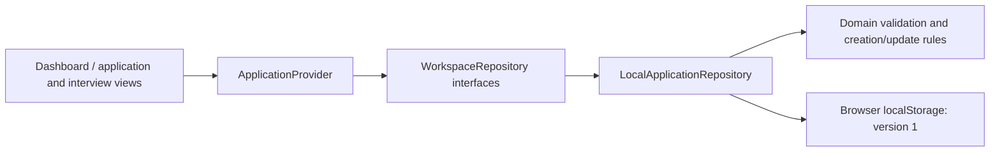

# Architecture

## Confirmed decisions

The repository is a pnpm 11 workspace with Nx 23 task orchestration and local caching. The Next.js 16 App Router app uses React 19, strict TypeScript, Tailwind CSS 4, and small reusable native components. A Radix dialog provides accessible focus management and modal semantics; Lucide provides consistent icons. No backend or external service is created.

```text
apps/web/src/app          Routes, layout, global tokens/styles
apps/web/src/components   Shell, views, provider, reusable UI, job form
apps/web/src/lib          Local persistence adapter
libs/domain/src          UI-independent application/interview models and rules
tests/unit               Domain and persistence contract/failure tests
tests/e2e                Real browser journeys on desktop/mobile
tools/project.json       Nx quality targets
```

The `@fats/domain` workspace package exports TypeScript source; Next transpiles it through `transpilePackages`. A standalone package build is unnecessary for this private workspace. Explicit package scripts and Nx quality targets keep the initial dependency footprint smaller than multiple generator/executor plugins. The framework plugin can be added when its generators or task inference become useful.



Routes render inside one application provider. The provider loads after client hydration, reports loading/errors explicitly, and refreshes from the repository after successful writes. All views derive from that collection. A `storage` event refreshes other tabs; the adapter reads the current collection before each write.

`WorkspaceRepository` combines `ApplicationRepository` (`list`, `create`, `update`, `deleteApplication`), `InterviewRepository` (`listInterviews`, `upcomingInterviews`, `createInterview`, `updateInterview`), and `BackupRepository` (`exportBackup`, `previewRestore`, `restoreBackup`, `cancelRestore`). Listing can be scoped by application. The update contract supports detail edits, rescheduling, notes, completion, and cancellation. The adapter can later become an HTTP implementation without changing the model or view behavior. The provider accepts an injected workspace repository. A future backend will still need authentication, authorization, migrations, conflict policy, and durable error semantics; this interface is not a claim that backend work is already done.

## Model and persistence

An application has a UUID, title, company, source URL, location, description, status, and creation/update timestamps. New records start Saved. Updates preserve identity and creation time. Validation trims text, enforces required fields and length limits, and accepts only complete HTTP(S) URLs without embedded credentials. Descriptions render as escaped plain text; links open with `noopener noreferrer`.

Storage key: `fats.applications.v1`. Shape:

```json
{ "version": 1, "applications": [], "interviews": [] }
```

Phase 2 adds an optional `interviews` collection to the existing version 1 envelope. Phase 1 records without it load as zero interviews without modifying storage; the next successful write includes both collections. Keeping them in one `setItem` avoids partial updates across separate storage keys. Phase 1 application fields and IDs are preserved. This is backward read compatibility, not a downgrade guarantee: an older application build does not know to preserve interviews.

An interview stores its ID, application ID, title, stage, UTC `scheduledAt`, IANA `timeZone`, meeting URL/location, status, preparation notes, reflections, and creation/update instants. Company and job details are resolved through the parent. The domain module has no UI or storage imports. URLs allow HTTP(S) without credentials; notes render as plain text.

`resolveInterviewTime` converts date/time in the selected timezone using `Intl.DateTimeFormat` parts and candidate offsets around the appointment. It roundtrips candidates to the requested wall time, rejecting invalid calendar dates and skipped times and requiring earlier/later selection for repeated times. It preserves second-based historical offsets and handles half/quarter-hour zones and date-line skips. No host timezone conversion is used. An unchanged edit preserves the original instant, including a repeated-time occurrence. Changing the date/time/timezone clears any previous disambiguation choice. Timezone rules come from the runtime's ICU/IANA data; future rule changes may alter displayed wall time for an existing fixed instant.

Domain selectors group and sort interviews and derive upcoming records using an explicit `now`. Completed/cancelled interviews are excluded regardless of date; a past scheduled record stays scheduled. The provider updates its clock every 30 seconds and refreshes both collections after successful writes and cross-tab storage events. Dashboard counts and guidance use that same interview collection.

Stored records are validated before use, including IDs, dates, statuses, required details, safe URLs, and parent references. Unknown versions, malformed records, duplicate IDs, or missing parents cause a visible read error. Nothing is automatically cleared or overwritten. Failed writes reject; the previous persisted state and current form remain available. There is no silent in-memory fallback that pretends a write survived a reload.

Deletion policy is **restrict**: `deleteApplication` rejects while any interview references that application, including completed/cancelled history. No deletion UI is added. If external storage editing leaves an orphan, recovery requires privately backing up and repairing the envelope; records are never silently removed. Interview creation and reassociation validate the parent before writing. Scheduling never updates the application's recruitment status.

For developer-assisted recovery, first back up the raw site storage value privately using browser developer tools. Inspect the version and record schema against the adapter, and repair a copy before replacing data with the user's authorization. Never paste real job notes into shared logs or delete the original as a diagnostic step.

## Local data safety (Phase 2.1)

Settings provides client-side JSON export and previewed full-backup restore. The domain's `backup.ts` validates and projects the documented record fields for both storage reads and backups. Existing application rules moved unchanged to `application.ts` so shared validation can import them without a circular barrel dependency; `index.ts` preserves public exports.

Export uses one read of the FATS key for a consistent application/interview snapshot. Restore privately stages validated data and its original raw storage value; UI receives a token and counts. It rejects changes since preview, then replaces both collections through one `setItem`, without first clearing anything. Failed validation/reads/writes leave previous data intact. Successful restore updates the provider only after persistence succeeds. Corrupt current storage can be replaced only after a valid preview and explicit user confirmation.

The export has its own `fats-backup` format and version 1, independently of storage version 1. Unsupported versions are rejected at a future migration boundary; no migration is guessed. Generated Phase 1/2 data stays compatible. Application timestamps now use the same canonical ISO validation as interview timestamps, rejecting malformed manually edited dates. Backups are unencrypted, use only known FATS fields, and have a 10 MiB UTF-8 limit. Single-key atomicity does not provide cross-tab locking or crash durability.

See [BACKUPS.md](BACKUPS.md) for the complete format, validation, recovery flow, compatibility, and remaining limits.

## Tooling decisions

- pnpm 11.27.0, Node 24 LTS; exact direct versions and a lockfile.
- Nx 23.3.0, Next 16.4.0, React/React DOM 19.3.1, Tailwind 4.3.3.
- TypeScript 5.9.3 satisfies the installed TypeScript ESLint supported range (`<6.1`). Latest TypeScript 7 is outside that range.
- ESLint 9.39.5 is the compatible major for the installed Next React/import/accessibility plugins. Its upstream support has ended; upgrading the lint stack when those plugins support ESLint 10 is a tooling follow-up. No incompatible peer versions are forced.
- ESLint uses Next's flat presets and restricts UI imports in the domain. Prettier handles formatting.
- Vitest 5 tests rules and adapter behavior without UI dependencies. Playwright tests browser persistence and responsive interactions. Test dependencies are development-only.
- pnpm's build-script allowlist is explicit (`allowBuilds`); only required native/tool packages may build. Exact recent package exemptions in the workspace were generated by pnpm's release-age policy.

## Assumptions and limits

Browser storage is acceptable for a development vertical slice, not a hosted production system. It is synchronous internally, origin-scoped, bounded by the browser, and vulnerable to site-data deletion. Notes are not encrypted and are accessible to the same browser profile; no notes are sent to a server. Read-before-write reduces stale sequential updates but does not make simultaneous cross-tab writes transactional; the last write can win. Offline capture, conflict resolution, migrations between schema versions, and account security remain future work.

No bundled remote font is needed: the typography stack falls back to locally available Segoe UI/Arial. No CI service, cloud cache, container, database, secret, or deployment is added.

The development origin allowlist adds only `127.0.0.1`, so browser tests and local previews can use the loopback IP with the normal `pnpm dev` command. Next already allows `localhost`; broad hostname wildcards are unnecessary. Browser storage remains separate for each origin.

## Official references checked

- [Nx with Next.js](https://nx.dev/docs/technologies/react/next/introduction) and [starting an Nx workspace](https://nx.dev/docs/getting-started/start-new-project).
- [Next.js App Router](https://nextjs.org/docs/app/getting-started) and [Next.js 16 changes](https://nextjs.org/docs/app/guides/upgrading/version-16).
- [Development origins](https://nextjs.org/docs/app/api-reference/config/next-config-js/allowedDevOrigins), also checked against the installed Next.js documentation under `apps/web/node_modules/next/dist/docs/`.
- [Tailwind's Next.js integration](https://tailwindcss.com/docs/installation/framework-guides/nextjs).
- [Radix Dialog](https://www.radix-ui.com/primitives/docs/components/dialog) and [shadcn's Radix dialog pattern](https://ui.shadcn.com/docs/components/radix/dialog). The small local wrapper follows this composition without adding unused generated components or a CLI runtime dependency.
- [pnpm 11 settings](https://pnpm.io/settings).
- [Playwright web server configuration](https://playwright.dev/docs/test-webserver).

Registry versions and installed peer metadata were also checked. The lockfile is authoritative for this workspace.
