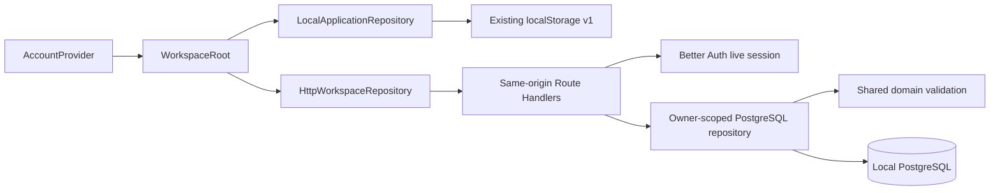
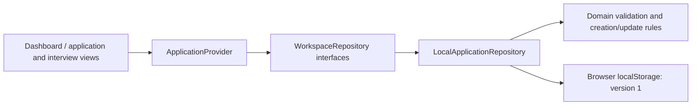

# Architecture

## Data protection hardening

[Hardening 1](PRIVATE_BETA_HARDENING_1_VERIFICATION.md) extends the existing architecture with migration 0008, durable file-write ownership, pending account erasure and database-backed upload admission. A committed access block/session revocation precedes child-first relational erasure and retryable private-file unlinking; SQL and filesystem work are separate steps. `pnpm data:cleanup` recovers requested deletions and tracked failed uploads without guessing from inventory. New document intake has owner/global/hourly admission, bounded stream lifetime and DOCX worker limits. No scanner or infrastructure is added, and real-data beta remains blocked. The Phase 5 descriptions below retain the original design context; the linked report specifies current behavior and operational exclusions.

## Confirmed decisions

Private beta readiness adds one default-off server configuration boundary: `FATS_AI_MATCHING_ENABLED` must be exactly `1` to render Phase 6 or use its endpoint. The route denies access before `getServices()`, and the handler repeats the guard before touching dependencies. This also protects stale tabs and direct API requests if provider credentials were accidentally configured. No schema/provider/domain changes or removal of historical reports are involved. All AI work remains paused. See [readiness and current verification](PRIVATE_BETA_READINESS.md).

The separately authorized non-AI [Offer Desk](OFFER_DESK.md) adds an account-only contextual application component, shared offer domain validation, and a same-origin Node endpoint. Migration 0006 stores one owner/application offer header plus immutable bounded history entries; no replay engine or new dependency is introduced. Exact salary values remain decimal strings. Owner workspace locks, optimistic offer versions, and fingerprinted UUID requests make header/history writes atomic and retries safe. Historical letters reference existing private document versions. Offer Desk 1.1 extends the existing backup parser and Settings flow with version 2 additive recovery, conflict blocking, full history validation, and explicitly unlinked letter provenance (migration 0007). Legacy JSON replacement/deletion guards preserve history; complete database/file archives retain both provenance and actual live links/bytes. All AI development remains paused.

The repository is a pnpm 11 workspace with Nx 23 task orchestration and local caching. The Next.js 16 App Router app uses React 19, strict TypeScript, Tailwind CSS 4, and small reusable native components. A Radix dialog provides accessible focus management and modal semantics; Lucide provides consistent icons. Phase 4 adds an optional same-origin Node API and local PostgreSQL; it provisions no cloud service.

## Account persistence (Phase 4)

[ADR 0001](decisions/0001-authentication-and-persistence.md) compares Next Route Handlers with NestJS and records the choice of Next, Better Auth 1.7.8, PostgreSQL 17, and parameterized SQL via `pg`. Kysely is a direct dependency because Better Auth's PostgreSQL dialect requires it; application persistence uses no ORM.



`apps/web/src/server` owns auth configuration, database services, HTTP boundary checks, transactions, and migrations. API routes are Node-only and never cache private responses. Account records are never cached in localStorage. Logout or a changed account remounts the workspace provider. An expired session blocks account writes and retains mounted form inputs for reauthentication; it never redirects those writes into the local workspace. A client account header detects stale tabs but does not authorize ownership.

Applications/interviews use `(user_id, id)` primary keys. The matching composite foreign key restricts parent deletion and forbids cross-account parents. UTC timestamps use `timestamptz`; explicit IANA timezone text remains beside the scheduled instant. Workspace row locks serialize writes; consistent snapshot reads prevent partially observed collections. Ordinary edits use last successful write; there is no per-record optimistic conflict UI. Replacement/migration previews use a base revision, owner-bound token, and 15-minute expiration. Confirm writes all records transactionally. A durable snapshot fingerprint prevents repeated local transfers, including a lost commit response.

SQL migrations have a checksum ledger, advisory lock, and transaction. Apply them explicitly before starting auth, whose installed version checks the schema during initialization. Development storage uses a named Docker volume; tests use a separate disposable database and loopback port. See [README setup](../README.md#accounts-and-local-postgresql--phase-41) and [Phase 4 verification](PHASE_4_VERIFICATION.md).

## Account safety and recovery (Phase 4.1)

[ADR 0002](decisions/0002-account-safety-and-recovery.md) records supported Better Auth verification/reset mechanisms and local recovery constraints. Email verification is required before login or workspace API access. The existing `emailVerified` flag and verification/rate-limit tables support this without a new migration. Existing accounts retain their records and must verify; their old sessions see a verification gate. Public sign-in/recovery routes render outside the workspace provider so a blocked or expired session cannot prevent recovery.

The email OTP plugin stores hashed eight-digit codes with 10-minute expiry, atomic consumption, five attempts, and resend rotation. Password reset uses 30-minute tokens and transactional token consumption, password change, and revocation of all sessions for that account. Reset links carry the token in a fragment, removed from browser history and submitted only in a JSON POST. No library token callback GET or alternate OTP login endpoint is exposed. Generic public feedback, shared database rate limits, bounded payloads, origin checks, and private responses apply at the server boundary. Session expiration remains seven days with daily refresh and no cookie-cached authorization.

Nodemailer delivers only to loopback Mailpit (no relay, remote credentials, or protocol/content logging). Token persistence is awaited; only SMTP delivery runs asynchronously, with a fixed safe failure log and user resend path. Local mail is not a durable queue. Runtime configuration refuses hosted account origins until a separately reviewed hosted delivery configuration exists. Test Mailpit is separate from the development inbox.

Operational backups use PostgreSQL 17 custom archives, an exported consistent snapshot, and a private checksum/migration/count manifest. Restore requires an independently configured target, explicit confirmation, compatibility and identity checks, and an idle destination. Schema/data restoration, count/ledger checks, and session/recovery/staging revocation commit in one transaction. JSON workspace backup compatibility is unchanged. See the [runbook](DATABASE_RECOVERY.md) and [executed Phase 4.1 evidence](PHASE_4_1_VERIFICATION.md).

The following sections describe the retained domain, guest adapter, and Phase 0–3 decisions. Account mode replaces the local persistence path as described above.

```text
apps/web/src/app          Routes, layout, global tokens/styles
apps/web/src/components   Shell, views, provider, reusable UI, job form
apps/web/src/lib          Local persistence adapter
apps/extension           MV3 service worker, bridge, React side panel, esbuild
libs/domain/src          UI-independent application/interview models and rules
tests/unit               Domain and persistence contract/failure tests
tests/e2e                Real browser journeys on desktop/mobile
tests/extension          Isolated Chromium capture/handoff journeys
tools/project.json       Nx quality targets
```

The `@fats/domain` workspace package exports TypeScript source; Next transpiles it through `transpilePackages`. A standalone package build is unnecessary for this private workspace. Explicit package scripts and Nx quality targets keep the initial dependency footprint smaller than multiple generator/executor plugins. The framework plugin can be added when its generators or task inference become useful.



Routes render inside one application provider. The provider loads after client hydration, reports loading/errors explicitly, and refreshes from the repository after successful writes. All views derive from that collection. A `storage` event refreshes other tabs; the adapter reads the current collection before each write.

`WorkspaceRepository` combines `ApplicationRepository` (`list`, `create`, `createCapturedApplication`, `update`, `deleteApplication`), `InterviewRepository` (`listInterviews`, `upcomingInterviews`, `createInterview`, `updateInterview`), and `BackupRepository` (`exportBackup`, `previewRestore`, `restoreBackup`, `cancelRestore`). Listing can be scoped by application. The update contract supports detail edits, rescheduling, notes, completion, and cancellation. The provider accepts an injected workspace repository. Phase 4 supplies the HTTP/server adapters, authentication, ownership checks, migrations, transactional writes, and safe retry behavior through this boundary.

## Private document storage (Phase 5)

[Document design](DOCUMENTS.md) describes the Node API, validation subset, limits, failure states, and local setup. Migration 0004 adds owner-scoped documents, immutable versions, exact application/version links, and a durable deletion queue. Composite foreign keys enforce ownership and restrict references. A partial unique index permits one active default resume. Document state stays separate from the application/interview and version 1 JSON contracts.

Uploads are bounded raw streams; live verified sessions determine ownership for every operation. PDF parsing runs in a time/heap-bounded native worker, which resolves its installed parser at runtime without Next's virtual module IDs. DOCX ZIP/CRC/size checks and namespace-aware XML validation precede persistence. No uploaded content becomes executable HTML. Downloads are private, integrity-checked, and authenticated; previews paint canvas pixels through local PDF.js without a document HTML/annotation/scripting layer.

`DocumentStorage` abstracts immutable private bytes. The local adapter uses canonical private directories, opaque UUID filenames, exclusive synced publication, no-follow reads, and size/SHA-256 verification. Transactions lock each owner workspace for quota/version/reference changes. Metadata appears only after durable file publication. Lost responses retry by version request ID. Unreferenced partial files can remain after a crash; the read-only audit reports them, and only durable deletion queue entries authorize application cleanup.

Database backup produces a version 2 manifest and paired verified document directory. A global advisory lock excludes document mutations while the database snapshot and immutable bytes are captured. Restore requires a fresh independently selected file directory and database target; it verifies/copies bytes before the transactional database replacement and revokes sessions/tokens. Bytes remain private after an attempted SQL restore fails or has an uncertain result; stop the app and inspect before retrying. JSON replacement refuses existing submitted links, avoiding silent history loss. [Recovery runbook](DATABASE_RECOVERY.md) and [executed evidence](PHASE_5_VERIFICATION.md) define the supported local guarantees.

## Explainable comparison (Phase 6)

[Matching design](MATCHING.md) describes the full security, extraction, privacy, cost, and accuracy boundaries. A focused account-only application component first requests a local extraction preview, then requires explicit consent before a server-side `MatchingProvider` call. The initial adapter pins OpenAI `gpt-5.4-mini-2026-03-17`, uses strict Structured Outputs and `store:false`, has no tools/retries, and never exposes credentials. No provider configured means unavailable; automated fixtures are explicitly labelled and restricted to the dedicated loopback test database.

Migration 0005 adds a trigger-maintained job-description revision, owner-scoped temporary previews and historical reports, and independent persistent UTC-day usage counters. Composite application/version foreign keys enforce ownership and restrict report-parent deletion. Each report binds exact immutable resume version, description revision/hash, reviewed source segments, and analysis configuration. New uploads never change reports; description edits mark them outdated. JSON replacement refuses reports, and exports omit them. Operator archives preserve completed reports/usage and paired files; restoration discards previews and marks in-flight analysis interrupted without rerunning it.

PDF.js text extraction uses a time/heap-bounded native worker; DOCX reuses validated ZIP entries and bounded saxes body parsing. Both produce source segments with locations and preserve empty/unsupported/failed/limit states. Extraction has per-account/global admission and daily attempt caps. Normalization/contact redaction is best effort and all sources are reviewed before sharing. No macros, actions, external references, or source instructions are executed. Strict domain validation rejects invalid or invented citations/prose/scores and applies conservative lexical evidence checks; application-written templates supply suggestions. Valid citations do not prove semantic truth or complete requirement coverage. Reports render plain text and make no changes to original documents/applications. Local 30-day retention is opportunistic, not a scheduled deletion guarantee.

## Model and persistence

An application has a UUID, title, company, source URL, location, description, status, and creation/update timestamps. New records start Saved. Updates preserve identity and creation time. Validation trims text, enforces required fields and length limits, and accepts only complete HTTP(S) URLs without embedded credentials. Descriptions render as escaped plain text; links open with `noopener noreferrer`.

Storage key: `fats.applications.v1`. Shape:

```json
{ "version": 1, "applications": [], "interviews": [] }
```

Phase 2 adds an optional `interviews` collection to the existing version 1 envelope. Phase 1 records without it load as zero interviews without modifying storage; the next successful write includes both collections. Keeping them in one `setItem` avoids partial updates across separate storage keys. Phase 1 application fields and IDs are preserved. This is backward read compatibility, not a downgrade guarantee: an older application build does not know to preserve interviews.

An interview stores its ID, application ID, title, stage, UTC `scheduledAt`, IANA `timeZone`, meeting URL/location, status, preparation notes, reflections, and creation/update instants. Company and job details are resolved through the parent. The domain module has no UI or storage imports. URLs allow HTTP(S) without credentials; notes render as plain text.

`resolveInterviewTime` converts date/time in the selected timezone using `Intl.DateTimeFormat` parts and candidate offsets around the appointment. It roundtrips candidates to the requested wall time, rejecting invalid calendar dates and skipped times and requiring earlier/later selection for repeated times. It preserves second-based historical offsets and handles half/quarter-hour zones and date-line skips. No host timezone conversion is used. An unchanged edit preserves the original instant, including a repeated-time occurrence. Changing the date/time/timezone clears any previous disambiguation choice. Timezone rules come from the runtime's ICU/IANA data; future rule changes may alter displayed wall time for an existing fixed instant.

Domain selectors group and sort interviews and derive upcoming records using an explicit `now`. Completed/cancelled interviews are excluded regardless of date; a past scheduled record stays scheduled. The provider updates its clock every 30 seconds and refreshes both collections after successful writes and cross-tab storage events. Dashboard counts and guidance use that same interview collection.

Stored records are validated before use, including IDs, dates, statuses, required details, safe URLs, and parent references. Unknown versions, malformed records, duplicate IDs, or missing parents cause a visible read error. Nothing is automatically cleared or overwritten. Failed writes reject; the previous persisted state and current form remain available. There is no silent in-memory fallback that pretends a write survived a reload.

Deletion policy is **restrict**: `deleteApplication` rejects while any interview references that application, including completed/cancelled history. No deletion UI is added. If external storage editing leaves an orphan, recovery requires privately backing up and repairing the envelope; records are never silently removed. Interview creation and reassociation validate the parent before writing. Scheduling never updates the application's recruitment status.

For developer-assisted recovery, first back up the raw site storage value privately using browser developer tools. Inspect the version and record schema against the adapter, and repair a copy before replacing data with the user's authorization. Never paste real job notes into shared logs or delete the original as a diagnostic step.

## Local data safety (Phase 2.1)

Settings provides client-side JSON export and previewed full-backup restore. The domain's `backup.ts` validates and projects the documented record fields for both storage reads and backups. Existing application rules moved unchanged to `application.ts` so shared validation can import them without a circular barrel dependency; `index.ts` preserves public exports.

Export uses one read of the FATS key for a consistent application/interview snapshot. Restore privately stages validated data and its original raw storage value; UI receives a token and counts. It rejects changes since preview, then replaces both collections through one `setItem`, without first clearing anything. Failed validation/reads/writes leave previous data intact. Successful restore updates the provider only after persistence succeeds. Corrupt current storage can be replaced only after a valid preview and explicit user confirmation.

The export has its own `fats-backup` format and version 1, independently of storage version 1. Unsupported versions are rejected at a future migration boundary; no migration is guessed. Generated Phase 1/2 data stays compatible. Application timestamps now use the same canonical ISO validation as interview timestamps, rejecting malformed manually edited dates. Backups are unencrypted, use only known FATS fields, and have a 10 MiB UTF-8 limit. Single-key atomicity does not provide cross-tab locking or crash durability.

See [BACKUPS.md](BACKUPS.md) for the complete format, validation, recovery flow, compatibility, and remaining limits.

## User-confirmed capture (Phase 3)

`apps/extension` is an independently built Chrome Manifest V3 application, with a React side panel, service worker, and narrowly scoped isolated-world content bridge. Esbuild bundles local assets without a Next runtime. The shared domain exports the versioned `fats-sidekick` draft contract, text/application validation, permitted FATS origins, expiry rules, and URL comparison. Storage and backup schemas remain unchanged.

The toolbar action opens the panel and grants temporary `activeTab` access. Capture Job injects a bounded extraction function only into the current top frame. It inspects JobPosting JSON-LD first, then basic metadata/semantic HTML; missing/ambiguous details require user edits. HTML descriptions are converted to inert plain text. It never fetches pages, traverses links, or runs site-supplied code.

Review → Open FATS stages one draft in extension `storage.session` and opens `/sidekick#<UUID>` on the chosen exact local origin. The URL contains no job fields. The packaged content bridge forwards same-window/origin correlated requests; the worker checks extension identity, sender URL/origin/top frame, destination binding, draft ID, and 15-minute validity. There is no external messaging endpoint. Chrome match patterns cannot restrict ports, so runtime checks enforce port 3000 and the exact `/sidekick` path. Neither extension code nor page messages can manage application records.

The website validates the draft again and presents editable fields. Only explicit confirmation calls the existing provider/repository. `createCapturedApplication` reads the current workspace, validates the capture and edited input, and either returns an existing ID/posting URL or writes one new Saved record. A synchronous UI submission guard and repository identity check prevent repeated sequential submissions. Canonical URL comparison removes only fragments; query parameters remain significant. Existing records are never overwritten. Concurrent writers still have the documented local-storage race, including simultaneous confirmations from multiple tabs.

Work arrangement is combined with location on creation; the existing model, interviews, timestamps, and backup contracts stay compatible. Session drafts are not backups. Extension reload/restart clears them; a new handoff replaces the prior one. Expired drafts are rejected and removed on retrieval, rather than by a guaranteed timer. Saved data remains in the website's origin-specific local repository.

See [SIDEKICK.md](SIDEKICK.md) for the pre-implementation decision, exact permissions, developer workflow, and browser-test limits.

## Tooling decisions

- pnpm 11.27.0, Node 24 LTS; exact direct versions and a lockfile.
- Nx 23.3.0, Next 16.4.0, React/React DOM 19.3.1, Tailwind 4.3.3.
- TypeScript 5.9.3 satisfies the installed TypeScript ESLint supported range (`<6.1`). Latest TypeScript 7 is outside that range.
- ESLint 9.39.5 is the compatible major for the installed Next React/import/accessibility plugins. Its upstream support has ended; upgrading the lint stack when those plugins support ESLint 10 is a tooling follow-up. No incompatible peer versions are forced.
- ESLint uses Next's flat presets and restricts UI imports in the domain. Prettier handles formatting.
- Vitest 5 tests rules and adapter behavior without UI dependencies. Playwright tests browser persistence and responsive interactions. Test dependencies are development-only.
- pnpm's build-script allowlist is explicit (`allowBuilds`); only required native/tool packages may build. Exact recent package exemptions in the workspace were generated by pnpm's release-age policy.

## Assumptions and limits

Browser storage is acceptable for a development vertical slice, not a hosted production system. It is synchronous internally, origin-scoped, bounded by the browser, and vulnerable to site-data deletion. Notes are not encrypted and are accessible to the same browser profile; no notes are sent to a server. Read-before-write reduces stale sequential updates but does not make simultaneous cross-tab writes transactional; the last write can win. Offline capture, conflict resolution, migrations between schema versions, and account security remain future work.

No bundled remote font is needed: the typography stack falls back to locally available Segoe UI/Arial. No CI service, cloud cache, container, database, secret, or deployment is added.

The development origin allowlist adds only `127.0.0.1`, so browser tests and local previews can use the loopback IP with the normal `pnpm dev` command. Next already allows `localhost`; broad hostname wildcards are unnecessary. Browser storage remains separate for each origin.

## Official references checked

- [Nx with Next.js](https://nx.dev/docs/technologies/react/next/introduction) and [starting an Nx workspace](https://nx.dev/docs/getting-started/start-new-project).
- [Next.js App Router](https://nextjs.org/docs/app/getting-started) and [Next.js 16 changes](https://nextjs.org/docs/app/guides/upgrading/version-16).
- [Development origins](https://nextjs.org/docs/app/api-reference/config/next-config-js/allowedDevOrigins), also checked against the installed Next.js documentation under `apps/web/node_modules/next/dist/docs/`.
- [Tailwind's Next.js integration](https://tailwindcss.com/docs/installation/framework-guides/nextjs).
- [Radix Dialog](https://www.radix-ui.com/primitives/docs/components/dialog) and [shadcn's Radix dialog pattern](https://ui.shadcn.com/docs/components/radix/dialog). The small local wrapper follows this composition without adding unused generated components or a CLI runtime dependency.
- [pnpm 11 settings](https://pnpm.io/settings).
- [Playwright web server configuration](https://playwright.dev/docs/test-webserver).

Registry versions and installed peer metadata were also checked. The lockfile is authoritative for this workspace.
