# PDF Tools 2.0 — design review

20 October 2026 · Design prototype and specification · **Approval pending**

The proposal replaces the current editor's persistent form/control column with a
document workspace. Quick Sign emphasizes Signature and keeps extra tools out of
the way. Edit PDF shares the same pages, marks and undo history, revealing only
the properties of the selected object. Read the complete
[experience specification](PDF_TOOLS_2_DESIGN.md) for personas, journeys, exact
interactions, feature priorities, acceptance criteria and implementation gates.

## Preflight and scope

- HEAD is `0ad1a069527047c29f912a3a0a7d702cf1fa69d5`, the dashboard/dark-mode
  checkpoint. The earlier PDF MVP is committed at `6297c1b`.
- **The immediately preceding integration/demo work is not committed, and the
  working tree was not clean.** Its 13 tracked changes and existing untracked
  demo/test/documentation files were present before this task. They are preserved.
  The requested clean-milestone preflight condition therefore remains unmet.
  The explicit instruction not to commit takes precedence over making it clean.
- Read root/web instructions and the installed Next 16.4 page, client-component
  and CSS-module guides before implementation. Existing React, native controls,
  Radix dialogs, Lucide icons and semantic theme roles were sufficient. No
  dependency, lockfile, root script or production navigation change was needed.
- Inspected the existing PDF components/model/worker boundary, documentation,
  FATS moodboard and real integration screenshots. All four currently tracked
  moodboard PNGs were preserved, including the three original references.
- **No DocHub screenshot was supplied or located in the task assets.** Its
  specific interaction-pattern review is still pending. No borrowed branding,
  artwork or document content is present.

All new UI code is under `apps/web/src/components/pdf-tools-design/` with one
development-only page at `/design/pdf-tools`. CSS is scoped; its route-qualified
background-shell rules prevent hidden app controls entering prototype focus order.
The sample uses HTML and memory-only data, not a PDF parser or alternative intake
path. The existing production editor, document provider, scanner, quarantine,
storage adapters, server authorization and AI configuration are unchanged.

The three sample pages and all names, employers, terms and dates are fictional.
Signature marks are visual only. File opening and export are deliberately
simulated. There is no file picker, generated PDF, real file download, account
write, signature library or certified signing mechanism.

## What is interactive

| Working prototype interaction                                                            | Deliberate limit                                                                     |
| ---------------------------------------------------------------------------------------- | ------------------------------------------------------------------------------------ |
| Quick Sign / Edit PDF switch with one shared sample                                      | No production editor replacement                                                     |
| Type signature, choose style, draw/clear with a pointer, cancel with draft clearing      | System-font HTML/SVG appearances; no real PDF glyph/export validation                |
| Click/tap placement and explicit known sample-line placement                             | Sample coordinates; no real signature-field detection                                |
| Move, resize, nudge, numeric geometry, select/delete                                     | One functional corner; touch hit area must be redesigned independently of page zoom  |
| Added text, initials, fixed sample date, checkmarks; text size/weight and blue/black ink | Single-line synthetic fields only; no original-paragraph editing/OCR                 |
| Three on-page fields, page navigation, thumbnails, reorder/remove and combined undo      | No real AcroForm integration, rotation, drag page reordering or engine serialization |
| Fit page/Fit width, bounded zoom, scrolling, contextual properties                       | No pinch, center-anchored zoom or physical virtual-keyboard evaluation               |
| Simulated export progress, failure, preserved-state retry and completion                 | No PDF file; completion explicitly keeps work unsaved                                |
| Exit/restart/sample-replacement guard and native unload listener                         | No durable drafts; browser Back/OS termination unresolved                            |
| Light/Dark/System using the existing provider                                            | Only appearance preference persists; sample content never does                       |
| Inspectable loading/empty/unsupported/password/render-error states                       | Reviewer-selected compositions, not real parser/security tests                       |

## Prototype gallery

Actual Chromium renders. Desktop is 1440×1000 CSS pixels, tablet 1024×900,
mobile 390×844. Files use CSS-pixel capture scale; tablet/mobile are Chromium
touch emulations, not physical-device evidence. The white document and blue ink
retain their appearance while the surrounding workspace follows the theme.

### Desktop light

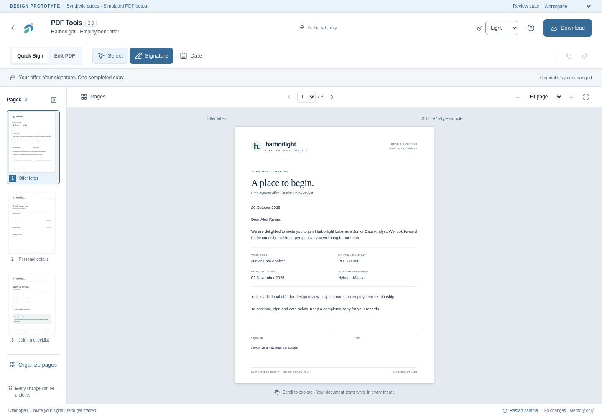

### Desktop dark

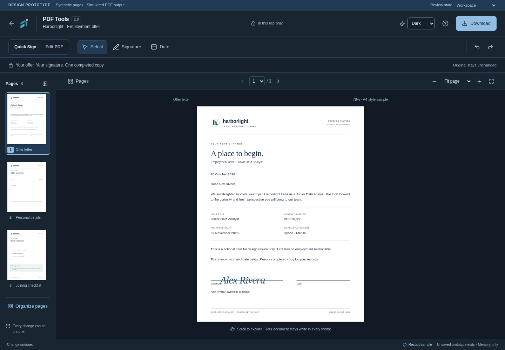

### Tablet

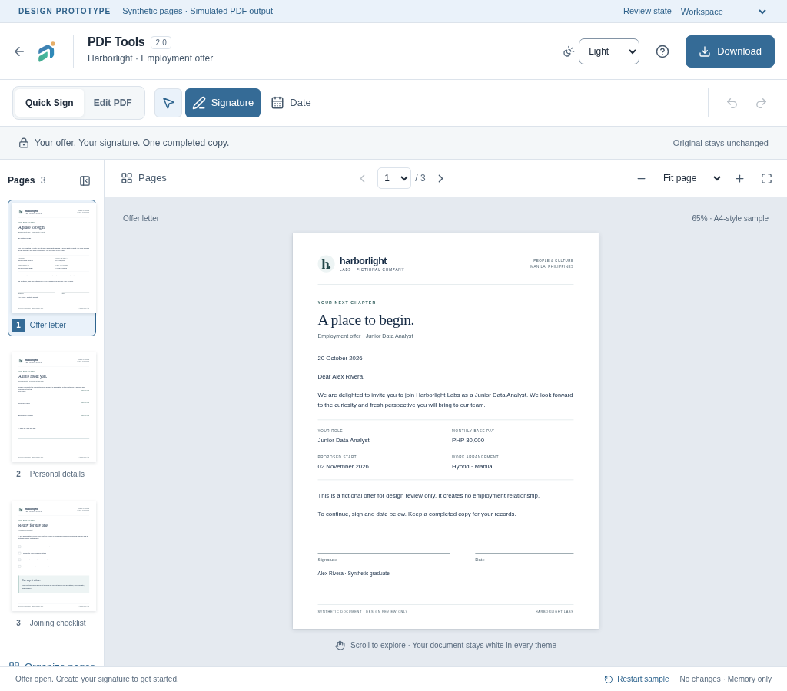

### Mobile

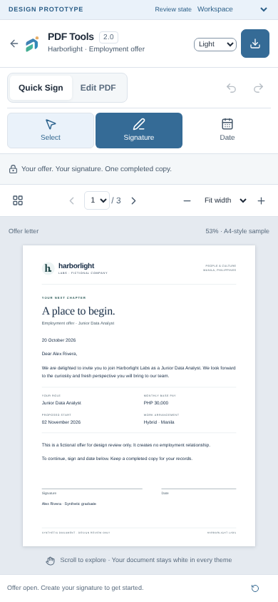

### Create a signature

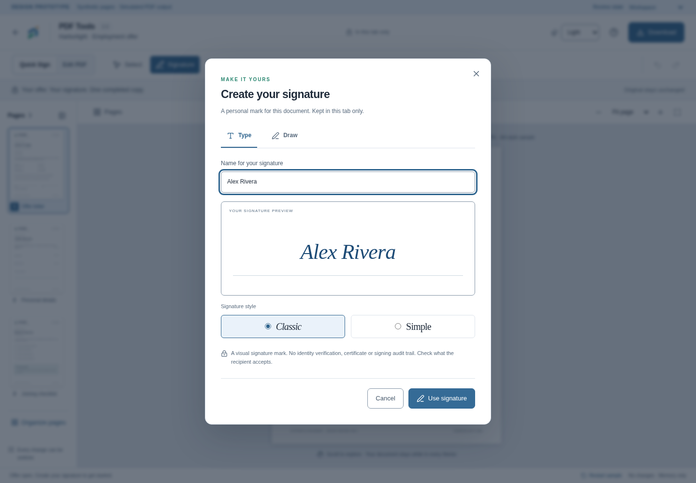

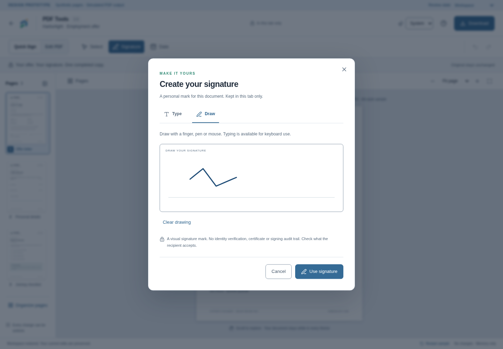

### Select and resize

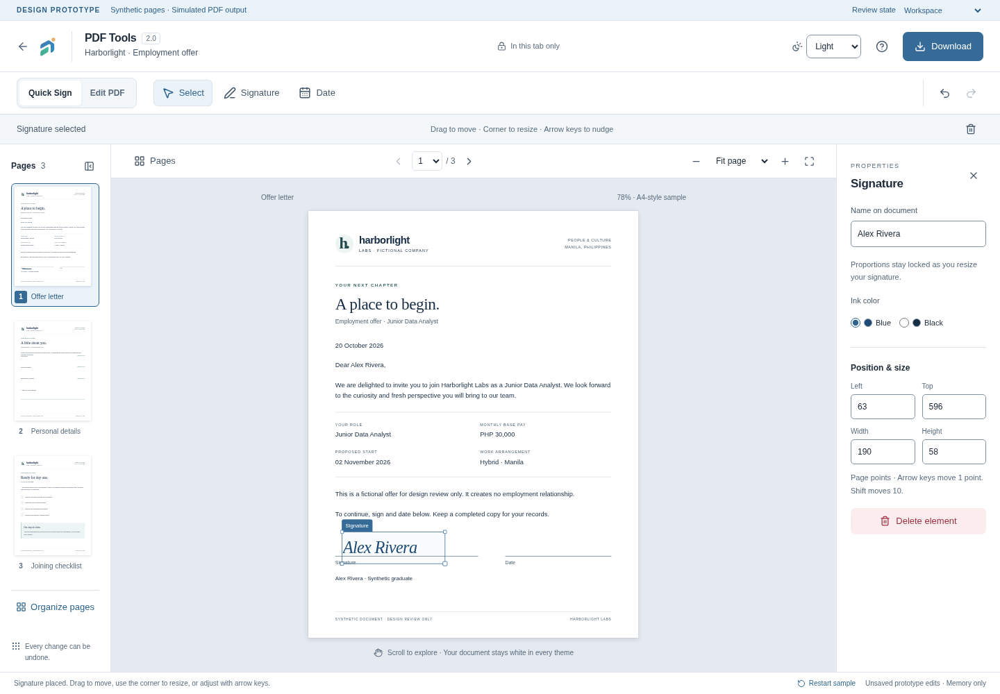

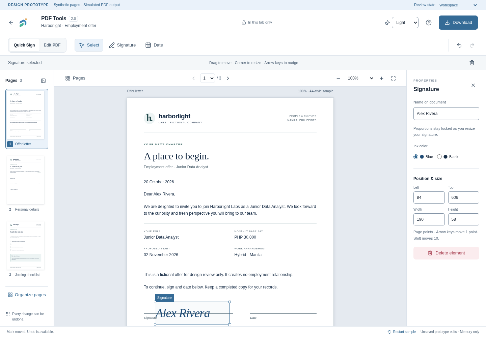

### Text editing

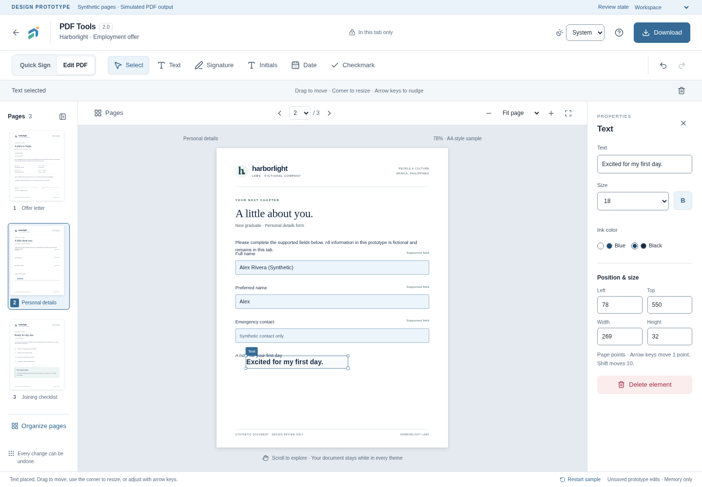

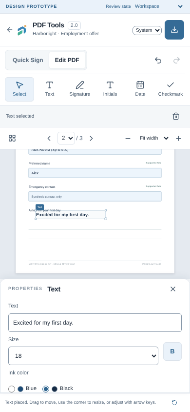

### Multi-page navigation

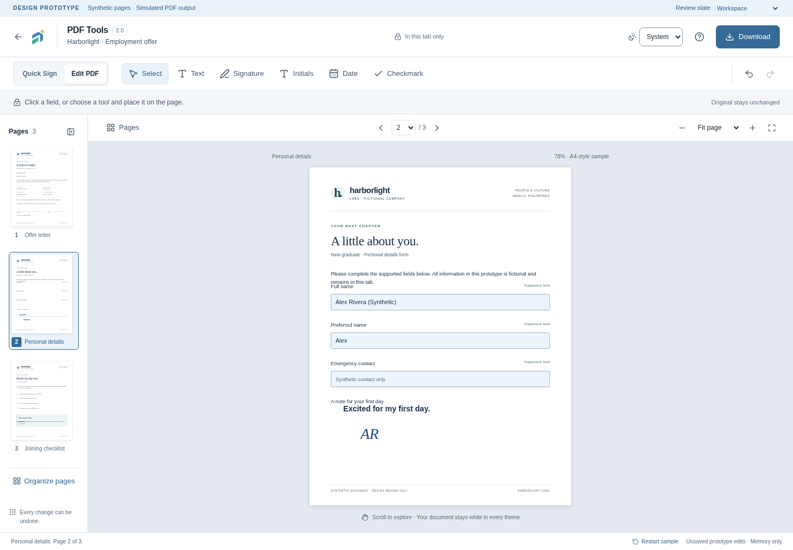

### Feedback and empty state

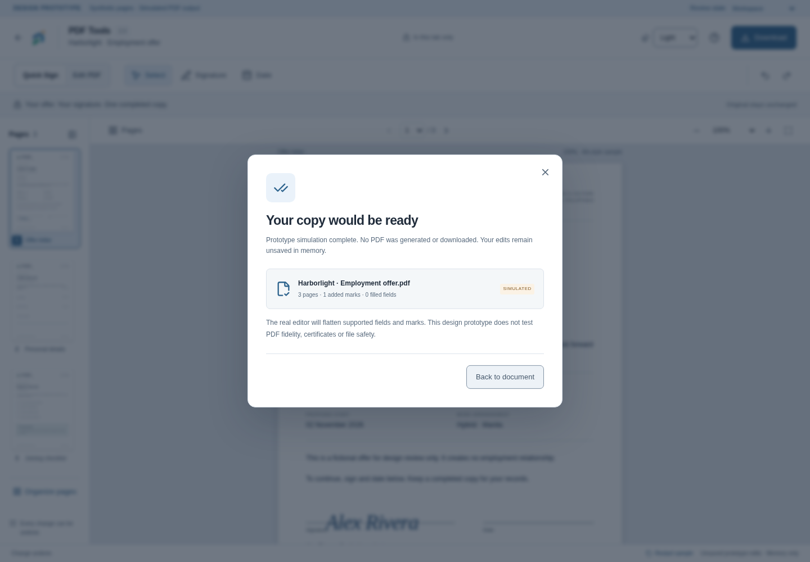

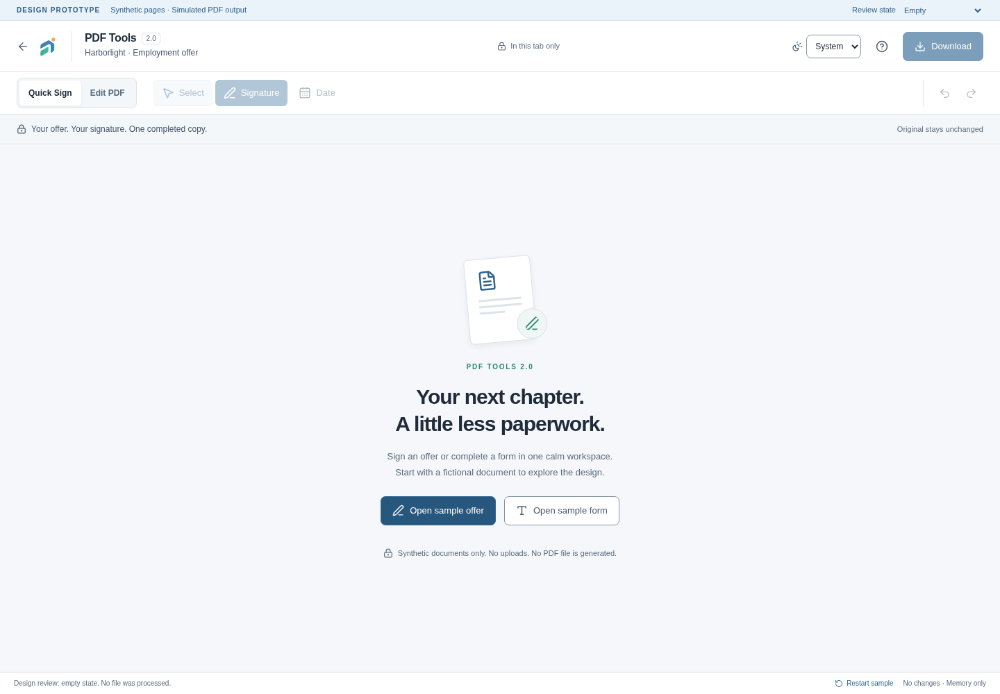

## Visual inspection and iteration

Inspected actual renders of the existing editor and the new prototype, not just
DOM snapshots. The baseline editor placed a tall field/tool card beside the
document. The prototype gives the page its own stage and keeps controls compact.
The printed fictional offer uses editorial typography; the FATS chrome retains
the established local sans-serif stack and semantic roles.

| Finding                                                               | Refinement / current decision                                                                                                                       |
| --------------------------------------------------------------------- | --------------------------------------------------------------------------------------------------------------------------------------------------- |
| Initial sample instructions intruded into the signature area          | Shortened synthetic letter copy and reserved a separate signing area; selected-mark screenshot now shows a clear gap                                |
| Mobile properties could cover the signing location                    | Properties became a bounded, independently scrollable tray that occupies layout space; the selected mark scrolls into view                          |
| Mobile Fit page reduced the document too much when properties opened  | Start mobile in Fit width; Fit page remains available as an explicit overview                                                                       |
| Hidden mobile Download text also removed its accessible name          | Added a persistent accessible name and verified the named action in the mobile journey                                                              |
| Signature style preview did not initially carry into placement        | Preserve the selected style in the in-memory mark                                                                                                   |
| Added single-line text could clip after content/size edits            | Expand its approximate content box during edits, bounded to the sample page. Exact font measurement/overflow warning remains an implementation gate |
| Fullscreen design left ordinary shell controls behind it              | Route-qualified CSS hides only the background shell while the prototype is mounted; browser checks require the old topbar to be hidden              |
| Quick Sign's first action needed clearer emphasis                     | Signature receives primary-action styling until a signature has been placed                                                                         |
| Selecting an empty review state could allow silent sample replacement | Sample entry and Restart now share the same explicit discard guard                                                                                  |

Remaining weaknesses for design review:

1. The mobile tray still takes substantial height while editing text; a collapsed
   selection summary may be preferable. Physical onscreen keyboards are untested.
2. Scaled document fields and the illustrated resize handle can be too small for
   reliable touch at Fit width. Production needs screen-space hit targets and a
   non-drag properties path at every scale; this prototype is not accessibility
   conformance evidence.
3. Paper text is intentionally small in an overview. Users need Fit width/zoom
   for reading. Validate toolbar density at 320px and browser text enlargement.
4. Three visual corners are not interactive. Before engineering, either implement
   equivalent handles or simplify the affordance to the supported corner.
5. HTML/SVG geometry and approximate text sizing cannot establish real PDF
   crop/rotation, font fidelity, signature baseline accuracy or export consistency.
6. A real accessible document reading strategy, field validation feedback,
   original supported field types and screen-reader workflows need dedicated
   design/engineering validation. The sample's printed artwork is hidden from
   assistive technology, while its fields and marks are named and operable.
7. Known sample-line placement must never be mistaken for detection on arbitrary
   employment files. The production alternative should say **Place on page**.
8. A long signature may become too small after fitting. Set a minimum readable
   mark size and overflow feedback before real export work.

## Verification evidence

Environment: Node 24.21.0, pnpm 11.27.0, installed Next 16.4.0 and Playwright
1.64.1, system Chromium, sandbox enabled. Development/browser operations needed
scoped execution permission after the restricted server returned loopback EPERM
and Chromium's system socket was blocked. No sandbox setting or system package
was changed. Dedicated test contexts start with empty storage; database and AI
configuration are explicitly empty/disabled for browser servers.

The first browser batch passed all three Edit PDF journeys; six other cases
stopped at an overly strict label-based theme selector. Switching the harness to
the existing control's accessible combobox name resolved those harness failures.
A later batch passed eight cases and exposed the unnamed mobile Download action;
that was a prototype accessibility defect and was fixed. Subsequent complete
browser evidence passed all nine journeys. Failures remain in ignored local
iteration directories and were not treated as successful checks.

| Result | Executed check / scope                                                                                                                                                                                                                   |
| ------ | ---------------------------------------------------------------------------------------------------------------------------------------------------------------------------------------------------------------------------------------- |
| PASS   | `FATS_TEST_PORT=3200 pnpm exec playwright test --config=playwright.design.config.ts --output=.fats-private/pdf-tools-2-review/final` — 9/9 journeys across desktop, tablet and mobile, including initials and guarded sample replacement |
| PASS   | `pnpm exec vitest run tests/unit/pdf-tools.test.ts tests/unit/pdf-tools-worker.test.ts tests/unit/theme.test.ts` — 24/24 existing PDF/model/worker/theme cases                                                                           |
| PASS   | `pnpm exec tsc --noEmit -p apps/web/tsconfig.json` and `pnpm exec tsc --noEmit -p tsconfig.tools.json` — web and test/config TypeScript                                                                                                  |
| PASS   | Scoped ESLint over the design components, route, browser tests and config with `--max-warnings=0`                                                                                                                                        |

| Result | Additional executed check / scope                                                                                                                                                                                                                                                                |
| ------ | ------------------------------------------------------------------------------------------------------------------------------------------------------------------------------------------------------------------------------------------------------------------------------------------------ |
| PASS   | `FATS_TEST_PORT=3200 pnpm exec playwright test --config=playwright.design.config.ts --project=desktop --grep 'Quick Sign' --output=.fats-private/pdf-tools-2-review/settled-capture` — one final journey after the screenshot helper began awaiting local font readiness and paint frames        |
| PASS   | `pnpm --filter @fats/web build` with database/provider configuration empty and scoped execution permission — optimized Turbopack production compile, TypeScript and all 19 static pages                                                                                                          |
| PASS   | `FATS_TEST_PRODUCTION=1 FATS_TEST_PORT=3201 pnpm exec playwright test tests/e2e/pdf-tools.spec.ts --output=.fats-private/pdf-tools-2-review/original-editor` — 4/4 unchanged desktop/mobile editor journeys, including real synthetic exports, reopening, unsupported files and discard handling |
| PASS   | Chromium against `next start` on loopback 3201: the design URL renders **This page isn’t here.**, has no prototype region and no sample-open action                                                                                                                                              |
| PASS   | SHA-256 comparison against the preflight manifest — all four moodboards and seven existing PDF component/model/worker files unchanged                                                                                                                                                            |
| PASS   | Comparison of tracked `git diff --numstat` with the saved preflight version — the original 13 tracked changes retained exactly; build-generated Next declaration path churn returned automatically to its starting development form                                                              |
| FAIL   | Root `NX_DAEMON=false NX_ISOLATE_PLUGINS=false pnpm build`, including a scoped verbose retry — the Nx subprocess hit Turbopack loopback binding EPERM. The direct package build above completed successfully; no repository workaround was added                                                 |

Final `pnpm format:check` and `git diff --check` **PASS**. All local
documentation/gallery links resolve. Final test/config TypeScript and focused
browser-test ESLint also **PASS** after the capture-helper refinement.

The production not-found check initially expected HTTP 404 and failed with 200.
The installed Next 16.4 [not-found guide](../apps/web/node_modules/next/dist/docs/01-app/03-api-reference/03-file-conventions/not-found.md)
explains that streaming can retain HTTP 200 while rendering the not-found UI.
Actual production-browser verification confirms that the prototype is unavailable;
this is not reported as an HTTP-404 pass. A first follow-up probe arrived after
the regression server had stopped; it was repeated against a separately started
local production server and passed. Both production servers were stopped.

The optimized build retains the two tracing warnings at unchanged
`apps/web/src/server/document-scanner.ts:40–41`, already documented in
[MVP verification](PDF_TOOLS_VERIFICATION.md). No scanner implementation was
changed to silence them.

An apparent blank-page concern during image inspection was checked against both
the original dark screenshot and a fresh theme/zoom render. Each contained 3,973
dark document pixels in the same 350×400px paper region; computed text was visible
with the expected ink color. A missing-content defect was not reproduced. The
gallery uses actual captures, with no retouching or fabricated document content.

Browser assertions cover signature-dialog focus containment and restoration,
cleared canceled drafts, confirmation-to-placement focus, selecting a new mark,
pointer movement, keyboard nudge, single-gesture resize, resize keys, delete/undo,
retained fields between pages, text properties, page reorder/removal/undo,
explicit unsaved exit, export-failure retry, System theme changes and pointer
drawing. Touch-emulated dragging uses actual Chromium touch input through CDP;
this is automated emulation, not a physical finger trial. Browser request monitors
check for script errors, console errors, non-GET writes and external origins.
All nine final prototype journeys observed none of those failures/writes/external
requests. The state/drawing scenarios also verify that only the existing
appearance preference is written to localStorage.

Reproduce the design suite with no other server on the chosen test port:

```sh
FATS_TEST_PORT=3200 pnpm exec playwright test --config=playwright.design.config.ts --output=.fats-private/pdf-tools-2-review/recheck
```

The design suite deliberately refuses `FATS_TEST_PRODUCTION=1`. Its page is
development-only. Build/browser commands must be sequential because they share
the same `.next` directory. No database, Mailpit, real file, scanner or provider is
needed for this suite.

## Acceptance status and next decision

The prototype supports reviewing the two journeys and the workspace's appearance
and interaction model. **No participant-based usability criterion has passed.**
The six-interaction budget, 90-second first-time signing target, placement
tolerances, tool-discovery times and responsive/a11y release gates are proposals
in the [acceptance matrix](PDF_TOOLS_2_DESIGN.md#7-measurable-acceptance-criteria).
Automated scripted completion cannot establish first-time intuition.

NOT RUN: graduate usability sessions; assistive-technology and screen-reader
testing; physical iOS/Android/stylus tests; full accessibility audit/contrast
measurement; 320px/200% zoom/virtual keyboard validation; genuine PDF preview/export
consistency or performance; DocHub screenshot comparison. Existing real-editor
regressions test the existing editor, not a future PDF Tools 2.0 engine.

Recommended decision: approve or revise the focused workspace, Quick Sign path,
selection properties and mobile tray before engineering. Then run formative
tasks, resolve target placement/field accessibility and the missing reference,
and authorize the first implementation milestone separately. Keep page
organization as a distinct model/export slice and library handoff deferred while
required scanning remains unavailable.

No deployment, commit, push, ClamAV install, AI activation, scanner bypass or
certified e-signature work was performed. The previous milestone remains
uncommitted by instruction.
