# PDF Tools 2.0 — design review

20 October 2026 · Refined design prototype · **Approval pending**

The proposal replaces the current editor's persistent form/control column with a
document workspace. Quick Sign emphasizes Signature and keeps extra tools out of
the way. Edit PDF shares the same pages, marks and undo history, revealing only
the properties of the selected object. Read the complete
[experience specification](PDF_TOOLS_2_DESIGN.md) for personas, journeys, exact
interactions, feature priorities, acceptance criteria and implementation gates.

## Final interaction and accessibility pass · 20 October 2026

**Recommendation: ready to begin staged production engineering, subject to design
approval. No further broad design iteration is recommended.** The approved
workspace direction is retained. The four remaining interaction areas now have
working prototype behavior and a concrete engineering contract. This is not a
production-release or accessibility-conformance approval.

This pass began with the preceding refinement's five modified text files and
18 untracked screenshots present. Their work is continued, not reset. All earlier
screenshots and moodboards are preserved. New code remains under the synthetic
prototype; the production route guard/editor, PDF engine, security, quarantine,
storage, uploads and AI configuration are unchanged. No dependency was added.
The Nx quality inputs now include the prototype sources exercised by its new unit
tests, so cached test results cannot ignore changes to those sources.

### Before / after

| Area                                    | Before                                                                                                          | Final interaction design                                                                                                                                                                                                                                                                                                                                                                                                   |
| --------------------------------------- | --------------------------------------------------------------------------------------------------------------- | -------------------------------------------------------------------------------------------------------------------------------------------------------------------------------------------------------------------------------------------------------------------------------------------------------------------------------------------------------------------------------------------------------------------------- |
| Mobile keyboard                         | A full properties tray could compete with the software keyboard; selection reveal only followed tray expansion. | Follow the visual viewport's height/offset on narrow screens, compact to the active input and sticky Done header, and reveal both the selected page object and focused control. Pinch scale is excluded from keyboard detection. Normal window resizing remains a fallback.                                                                                                                                                |
| Editing and scrolling                   | Text marks updated only on blur; native form fields had tiny scaled input text.                                 | A stable, full-size property input shows a live mark draft. Supported fields use an unscaled value editor. Blur/Enter commits; Done collapses to the existing summary. Scrolling the page does not clear selection or draft. Closing the keyboard restores the normal layout without changing PDF zoom.                                                                                                                    |
| Touch targets                           | Only the resize handle had a screen-space target.                                                               | Signature, initials, text and checkmark hit regions are at least 44×44 CSS px independently of page zoom; the physical artwork/mark box stays unchanged. The single resize handle is offset with a connector so it does not consume a tiny mark's move target.                                                                                                                                                             |
| Supported fields in overview            | Three scaled form inputs could be too short and overlap if naively enlarged.                                    | At 50% and above, native field hit regions are at least 44px high. Below 50%, one grouped “3 fields · Edit” target opens the named field picker. No overlapping field hit regions are presented as separately usable inputs at overview scale.                                                                                                                                                                             |
| Page navigation and overlapping objects | Selection relied mainly on the page canvas and thumbnails.                                                      | Page contents lists the current page's fields and marks by name/value. Each can open properties without visual coordinates. It also links to the existing thumbnail chooser. Page controls/selects have 44px targets; narrow screens retain native zoom selection. Overlapping marks can always be selected through the list.                                                                                              |
| Long signatures                         | Character-count fitting could clip a preview or shrink a mark without a readable-size limit.                    | Measure both local styles with browser font metrics, widen the initial box before fitting, and enforce an 18pt document-size floor. Long previews scroll horizontally with explicit guidance. Names that cannot fit are rejected with feedback; placed text is preserved and problematic marks show “Needs more space.” Unreadable shrinking is rejected; invalid signatures block download preview until corrected.       |
| Keyboard and assistive controls         | Named tools existed, but there was no complete object navigation path or field-value editor.                    | Skip link, named document navigation/canvas, page groups and Page contents provide a logical editor structure. Enter opens mark properties; native field inputs lead to the value editor. Arrows/Shift+arrows, named 5-point movement buttons, the working resize handle and Advanced provide non-drag control. Deletion focuses Page contents, modal actions restore appropriate focus, and changes have status messages. |

The 18pt signature floor is a design choice in document coordinates, not a claim
that text remains readable at 25% screen zoom. Use PDF zoom or the full-size named
editor to inspect a mark. Signature sizing/resizing preserves aspect ratio,
including at page bounds. Editing the name can require a larger box or the other
style; the complete text is never replaced with a truncated stored value.
A wide signature still needs placement review: fitting the page does not prove
that it fits an arbitrary signing line or avoids another field.

The viewport behavior follows the [VisualViewport API](https://developer.mozilla.org/en-US/docs/Web/API/VisualViewport)
and accounts for the distinction between visual and layout viewport resizing
explained in [Chrome's keyboard viewport guidance](https://developer.chrome.com/blog/viewport-resize-behavior).
The 44px goal is the larger [W3C target-size design target](https://www.w3.org/WAI/WCAG21/Understanding/target-size),
not a claim of complete WCAG conformance. Native inputs, Radix modal semantics,
local fonts and existing theme roles are retained.

### Keyboard and accessibility findings

The browser journeys exercise a complete keyboard-only sample signing flow,
Page contents selection, precise resizing, deletion/Undo, simulated download,
page selection and supported-field editing using Tab, Enter and native select
keys. Browser accessibility-tree snapshots confirm named editor navigation,
fields, marks and properties, while the fictional printed letter is excluded.
This distinguishes editing controls from reading arbitrary PDF content; no PDF
reading order, tagging, OCR or accessible PDF remediation is implemented.

The mobile keyboard test explicitly simulates VisualViewport resize/offset
signals, including a 480px visible area, then restores the viewport and checks
320×560 layout. It checks live drafts, selected-field visibility, scrolling,
Done/focus restoration and numeric input reachability. This is an automated
viewport/keyboard simulation; no physical software keyboard was used. Actual
spoken screen-reader output, announcement timing, IME composition, iOS browser
panning and Android keyboard variants require the manual checks below.

### Touch measurements and signature matrix

The mobile and tablet touch journeys passed these rendered-bound checks:

| Target                                               | PDF zoom exercised                                              | Browser bound assertion                                                          | Stored geometry                                                              |
| ---------------------------------------------------- | --------------------------------------------------------------- | -------------------------------------------------------------------------------- | ---------------------------------------------------------------------------- |
| Signature, initials, text and checkmark move regions | 25%, 50%, 100%, 200%                                            | Width and height ≥43.9 CSS px (44px target; 0.1px fractional-rounding tolerance) | Same physical width/height at every zoom                                     |
| The single working resize handle                     | Actual touch resize at 25%; existing journeys at 100%/Fit views | Width and height ≥43.9 CSS px                                                    | Resize changes the mark intentionally; the hit region alone never changes it |
| Supported native field inputs                        | 50%, 100%, 200%                                                 | Height ≥43.9 CSS px; fixed document field artwork                                | Original field rectangle retained                                            |
| Grouped field selector                               | 25% overview                                                    | Height ≥44 CSS px; opens all three named fields                                  | No field/mark geometry change                                                |
| Previous/Next, Page contents, current-page select    | Mobile and tablet                                               | Each dimension ≥43.9 CSS px                                                      | View/navigation only                                                         |

The expected physical move displacement was also checked: a 12px touch move at
25% PDF zoom moves a mark 48 document points. Touch resize and deletion succeed
for all four mark kinds. Expanded inputs are deliberately grouped at overview
scales where independent 44px regions would overlap. These are editor-control
measurements, not a claim about a real PDF export or physical finger usability.
Measurements use browser `getBoundingClientRect()` in CSS pixels and actual CDP
touch input for moves and resize gestures. Model box dimensions are compared
across 25%, 50%, 100% and 200% PDF zoom. Empty-stage scrolling retains selection;
the object list resolves the inherent ambiguity of visually overlapping marks.

The typed-signature matrix uses the synthetic names `Li`, `Alex Rivera`,
`María José de la Cruz`, and `Alexandria Remedios Santiago Villanueva` in both
Classic and Simple styles. It also tests the last name repeated three times,
a post-placement name that overflows, refusal to shrink below readability, and
blocked preview until the problematic name is corrected. Actual text ranges are
checked against their physical mark boxes. Browser measurements cannot establish
PDF font embedding, glyph mapping, diacritic output or exported baselines.

### Final evidence gallery

Captures in `assets/pdf-tools-2-final/` are unretouched browser output using only
synthetic samples. The earlier galleries remain available for comparison.
Keyboard screenshots crop to the simulated visible area; they do not show or
claim a native operating-system keyboard.

Before/after examples: [previous text tray](assets/pdf-tools-2-refined/mobile-text-editing.png)
→ [keyboard text editor](assets/pdf-tools-2-final/mobile-keyboard-text.png);
[previous selected signature](assets/pdf-tools-2-refined/signature-selected.png)
→ [final selected signature](assets/pdf-tools-2-final/signature-selected.png).

| State                                   | Updated screenshot                                                                                                                                                 |
| --------------------------------------- | ------------------------------------------------------------------------------------------------------------------------------------------------------------------ |
| Desktop light                           | [desktop-light.png](assets/pdf-tools-2-final/desktop-light.png)                                                                                                    |
| Desktop dark                            | [desktop-dark.png](assets/pdf-tools-2-final/desktop-dark.png)                                                                                                      |
| Tablet                                  | [tablet.png](assets/pdf-tools-2-final/tablet.png)                                                                                                                  |
| Mobile light / dark                     | [mobile.png](assets/pdf-tools-2-final/mobile.png), [mobile-dark.png](assets/pdf-tools-2-final/mobile-dark.png)                                                     |
| Signature creation / selection          | [signature-creation.png](assets/pdf-tools-2-final/signature-creation.png), [signature-selected.png](assets/pdf-tools-2-final/signature-selected.png)               |
| Text selection                          | [text-editing.png](assets/pdf-tools-2-final/text-editing.png)                                                                                                      |
| Simulated keyboard: field / text        | [mobile-keyboard-field.png](assets/pdf-tools-2-final/mobile-keyboard-field.png), [mobile-keyboard-text.png](assets/pdf-tools-2-final/mobile-keyboard-text.png)     |
| Restored narrow layout                  | [mobile-restored-320.png](assets/pdf-tools-2-final/mobile-restored-320.png)                                                                                        |
| Named keyboard object selection         | [page-contents.png](assets/pdf-tools-2-final/page-contents.png)                                                                                                    |
| Long names, both styles                 | [long-signature-classic.png](assets/pdf-tools-2-final/long-signature-classic.png), [long-signature-simple.png](assets/pdf-tools-2-final/long-signature-simple.png) |
| Accented name                           | [accented-signature.png](assets/pdf-tools-2-final/accented-signature.png)                                                                                          |
| Creation overflow / invalid placed name | [signature-overflow.png](assets/pdf-tools-2-final/signature-overflow.png), [signature-needs-space.png](assets/pdf-tools-2-final/signature-needs-space.png)         |
| Touch-selected text at 25%              | [touch-text-25.png](assets/pdf-tools-2-final/touch-text-25.png)                                                                                                    |
| Explicit simulated completion           | [export-feedback.png](assets/pdf-tools-2-final/export-feedback.png)                                                                                                |

All 19 new images were opened and visually inspected, including both themes,
the reduced keyboard area and restored 320px layout. The original and preceding
refinement galleries remain byte-identical. There is no real personal data or
secret in these synthetic captures.

### Final verification results

| Result | Executed check / scope                                                                                                                                                                                                                                                                          |
| ------ | ----------------------------------------------------------------------------------------------------------------------------------------------------------------------------------------------------------------------------------------------------------------------------------------------- |
| PASS   | `pnpm exec tsc --noEmit -p apps/web/tsconfig.json` and `pnpm exec tsc --noEmit -p tsconfig.tools.json`                                                                                                                                                                                          |
| PASS   | `pnpm exec eslint apps/web/src/components/pdf-tools-design apps/web/src/app/design/pdf-tools/page.tsx tests/design-e2e tests/unit/pdf-tools-design.test.ts playwright.design.config.ts --max-warnings=0`                                                                                        |
| PASS   | `pnpm exec vitest run tests/unit/pdf-tools-design.test.ts tests/unit/pdf-tools.test.ts tests/unit/pdf-tools-worker.test.ts tests/unit/theme.test.ts` — 30/30 tests                                                                                                                              |
| PASS   | `FATS_TEST_PORT=3200 pnpm exec playwright test --config=playwright.design.config.ts --output=.fats-private/pdf-tools-2-final/final` — 21 passed, 3 deliberate skips, 1.8m. Touch runs on tablet/mobile; keyboard-viewport simulation runs on mobile, explaining the three non-applicable skips. |
| PASS   | `DATABASE_URL= BETTER_AUTH_URL= BETTER_AUTH_SECRET= FATS_AI_MATCHING_ENABLED=0 FATS_AI_PROVIDER= OPENAI_API_KEY= pnpm --filter @fats/web build` — optimized compile, TypeScript, 19/19 static pages, exit 0                                                                                     |
| PASS   | `node .fats-private/pdf-tools-2-final/check-production.mjs` — final production build renders not-found, with no prototype region or sample-open control; its own server/browser stopped. This is not an HTTP-404 claim.                                                                         |
| PASS   | `pnpm format:check`, `git diff --check`, gallery decoding and source-hash checks                                                                                                                                                                                                                |

The final browser run observed no script/console errors, external requests or
non-GET writes. Existing Quick Sign cases also observed no browser download from
the simulation. The two existing scanner tracing warnings at unchanged
`apps/web/src/server/document-scanner.ts:40–41` remain; no scanner repair or bypass
is included. Build-generated Next declaration imports were restored to their
starting content. Hash checks cover the 45 protected original files, including
all earlier screenshots, moodboards, original editor sources and the route guard.

Earlier iterations are retained privately and are not counted as passes. They
exposed the missing 25% menu choice, a 1px control-height/layout budget adjustment,
and the need to use Done after field editing. The first visual-viewport harness
froze its height before the viewport meta settings applied; it was corrected to
use the live height until explicitly overridden and to release that override on
restore. A misplaced dimension assertion in the expanded test was also corrected.
The successful final batch includes every applicable old and new journey.

NOT RUN: physical iOS/Android keyboards, real screen readers, participant sessions,
IME composition, actual browser text enlargement/pinch usability, full WCAG or
contrast audit, full production-editor browser regressions, account/database/live
provider suites, or real PDF export/reading/tagging validation. These are kept
separate from the passed prototype interaction and route-exclusion checks.

### Engineering handoff and remaining validation

- **Design issues resolved in the prototype:** keyboard-aware editing and
  collapse/restore behavior; selection-preserving scroll; screen-space touch
  targets with an overview picker; measured long-signature feedback and readable
  fitting; named, coordinate-free field/mark selection and keyboard alternatives.
- **Real PDF integration gates:** retain every existing supported field type;
  prove crop/rotation/coordinate mapping and gesture transactions; share the exact
  font/glyph source between preview and export; validate minimum size, slot
  collisions, field validation and diacritics in reopened synthetic PDF outputs.
  Keep the old editor until those engineering checks pass. No new engine feature
  is authorized by the prototype.
- **Physical-device / participant / assistive-technology validation:** run the
  short [manual verification checklist](PDF_TOOLS_2_MANUAL_CHECKLIST.md) on iOS
  Safari, Android Chrome and a real screen reader. Confirm keyboard dismissal,
  orientation, browser chrome, IME behavior, pinch/text zoom, spoken announcements
  and first-time task comprehension before release. These release gates do not
  require another broad workspace redesign before staged implementation begins.

## Previous refinement pass · 20 October 2026 (historical)

**Recommendation at that milestone: needed one focused interaction pass before
production implementation.** The workspace is ready for stakeholder review. Validate the
phone keyboard, supported-field touch targets, long signatures and an accessible
document-reading workflow before approving the production interaction contract.
No usability result is implied by the browser journeys.

This pass started with a clean Git working tree. Changes are confined to the
prototype workspace/styles, its browser journeys, this review, the matching
experience specification and a new screenshot directory. The development-only
route guard, original editor/model/worker, moodboards, original screenshots,
account/storage/upload/quarantine boundaries and AI settings are preserved.
There are no new dependencies. The earlier milestone evidence below is historical.

| Review finding            | Refinement                                                                                                                                                                                                                                                 | Why                                                                                                                                                                                           |
| ------------------------- | ---------------------------------------------------------------------------------------------------------------------------------------------------------------------------------------------------------------------------------------------------------- | --------------------------------------------------------------------------------------------------------------------------------------------------------------------------------------------- |
| Too much stacked chrome   | Removed the top review banner and permanent context strip. Kept a compact 60px header and roughly 54px workflow/tool row; view controls sit quietly on the canvas. Review-state controls moved to the footer.                                              | The paper starts around 202px down on desktop and 196px on a 390px phone, versus 304px and 344px in the original gallery.                                                                     |
| Quick Sign needs guidance | A three-step Create → Place → Download guide offers one next action: Create signature, Place on signature line, then Review & download.                                                                                                                    | The next step stays visible; placing the mark remains explicit. The fixed line target belongs only to this fictional sample.                                                                  |
| Properties feel technical | Content, ink and simple Smaller/Larger signature controls come first. Native Advanced disclosure holds all four geometry inputs and keyboard precision guidance.                                                                                           | Common edits do not require understanding document coordinates; exact positioning remains available.                                                                                          |
| Heavy thumbnail rail      | 124px rail, 84px paper previews, quieter selection and smaller captions. One view-control button collapses/reopens it, with accurate labels and expanded state.                                                                                            | Pages remain navigable without competing with the active document. Organization stays secondary.                                                                                              |
| Canvas lacks focus        | Centered paper/captions as one group, roomier gutters, softer layered paper shadow and a compact signing card below the stage. Fit sizing uses the actual stage content area.                                                                              | The document has a stable visual center and more space, especially in Edit PDF. Paper and ink retain their colors across themes.                                                              |
| Phone feels compressed    | Tools move to a labeled bottom dock. Selection starts as a compact Edit summary; new text/date placement opens controls directly. Done restores focus to the mark. Expanded controls replace the dock/guide, occupy layout space and scroll independently. | Editing is deliberate and reachable without a permanent tall tray covering the document. Inputs use 16px text; the single working resize handle has a 44px screen-space target at every zoom. |
| Ambiguous completion      | Review before downloading → Preview download → Preview complete. Completion explicitly says no PDF was created/downloaded and nothing was saved/sent. Keep editing is the final action. Failure preserves work and offers a retry.                         | A successful prototype preview cannot be mistaken for a saved document.                                                                                                                       |

Visual iteration also removed the three nonfunctional corner handles, corrected
wrapping in thumbnail captions, and moved the sample's default added text/initials
below the printed note label. Signature creation and the empty state retain their
established visual language. All names, employer details, amounts, dates, field
values and signatures in the captures are fictional; no personal data or secrets
were observed. Screenshots are unretouched Chromium renders, not composed mockups.
Original captures remain under `assets/pdf-tools-2/`; this gallery uses the new
`assets/pdf-tools-2-refined/` directory. The previously collected Downloads ZIP
has not been updated by this pass.

### Refinement verification

The existing stack is Node 24.21.0, pnpm 11.27.0, Next 16.4.0, Playwright 1.64.1
and sandboxed system Chromium. Checked the installed Next [CSS Modules guide](../apps/web/node_modules/next/dist/docs/01-app/01-getting-started/11-css.md#css-modules)
and [client boundary guide](../apps/web/node_modules/next/dist/docs/01-app/03-api-reference/01-directives/use-client.md) before editing. A restricted browser launch could not
reach loopback (`EPERM`); scoped execution permission allowed the existing local
browser harness to run. No Chromium sandbox bypass or system change was used.
The browser server receives empty database/auth/provider configuration and disabled
AI, as specified by the existing Playwright configuration.

| Result | Executed check / evidence                                                                                                                                                                                                            |
| ------ | ------------------------------------------------------------------------------------------------------------------------------------------------------------------------------------------------------------------------------------ |
| PASS   | `pnpm exec tsc --noEmit -p apps/web/tsconfig.json` and `pnpm exec tsc --noEmit -p tsconfig.tools.json` — web and test/config TypeScript; the final production build also completed TypeScript.                                       |
| PASS   | `pnpm exec eslint apps/web/src/components/pdf-tools-design apps/web/src/app/design/pdf-tools/page.tsx tests/design-e2e/pdf-tools-design.spec.ts playwright.design.config.ts --max-warnings=0`                                        |
| PASS   | `pnpm format:check` and `git diff --check`                                                                                                                                                                                           |
| PASS   | `FATS_TEST_PORT=3200 pnpm exec playwright test --config=playwright.design.config.ts --output=.fats-private/pdf-tools-2-refinement/final-polish` — 12/12 journeys, 50.3s, desktop/tablet/mobile plus a 320×740 phone check.           |
| PASS   | `pnpm exec vitest run tests/unit/pdf-tools.test.ts tests/unit/pdf-tools-worker.test.ts tests/unit/theme.test.ts` — 24/24 existing PDF/model/worker/theme cases.                                                                      |
| PASS   | `DATABASE_URL= BETTER_AUTH_URL= BETTER_AUTH_SECRET= FATS_AI_MATCHING_ENABLED=0 FATS_AI_PROVIDER= OPENAI_API_KEY= pnpm --filter @fats/web build` — optimized compile, TypeScript and 19 static pages.                                 |
| PASS   | `node .fats-private/pdf-tools-2-refinement/check-production.mjs` against the final build on loopback 3201 — not-found UI, no prototype region or sample-open button; temporary server/browser stopped. No HTTP-404 claim is made.    |
| PASS   | All 18 new gallery PNGs decode and match the final browser output byte for byte. Visually reviewed light/dark, tablet, 390px/320px phone, signing/placement/selection, text controls, Advanced, multi-page, empty and export states. |
| PASS   | SHA-256 checks of all 27 protected files — four moodboards, original PDF components/model/client/engine/worker, original 13 screenshots, development-only route and restored generated Next declarations.                            |

Browser assertions cover guide step progression, cancellation/focus restoration,
shared history, pointer/touch-emulated moves, resize/keyboard geometry, fields,
page organization/undo, theme changes, error states and guarded sample replacement.
New checks cover the hidden-by-default Advanced section, simple size controls,
rail hide/reopen with expanded state, mobile Edit/Done focus return, 44px resize
hit area, the absence of app overflow at 320px and a canvas beginning above 165px.
All twelve journeys observed no script/console errors, external requests or
non-GET writes; Quick Sign also observed no browser download during the preview.
Only the existing appearance preference is allowed in localStorage.

The build repeats the two scanner tracing warnings at unchanged
`apps/web/src/server/document-scanner.ts:40–41`, already recorded in the original
milestone below. No scanner repair is included. Its generated Next declaration
imports were restored to their starting development paths. The first temporary
production probe used an incorrect working directory and did not start; after
correcting that harness path, the final production check passed.

NOT RUN this pass: the full production editor browser suite, database/account or
live-provider suites, physical-device/usability/assistive-technology sessions,
200% zoom, full contrast audit or real PDF export fidelity. The production editor
is protected by unchanged source hashes and its existing focused unit coverage;
the production probe checks route exclusion, not editor behavior. The original
milestone's verification tables below are historical evidence, not rerun claims.

### Still open

- Physical iOS/Android keyboards, pinch/stylus behavior, screen readers and 200%
  browser zoom need evaluation. The 320px check is Chromium emulation, not a
  physical-device usability claim.
- The mark resize target is now screen-sized; scaled supported form fields and
  tiny marks still need dedicated touch and assistive-technology design. Advanced
  coordinates provide a non-drag alternative, not an accessibility certificate.
- Very long typed signatures can clip the creation preview or become too small
  when placed. Minimum readable size and overflow feedback remain undecided.
- HTML marks cannot establish actual PDF font/crop/rotation/export fidelity. The
  real editor's field types and accessible reading strategy must be retained.
- Browser Back and OS termination can still lose memory-only edits. There is no
  autosave or durable draft promise. No real PDF is produced by any export state.
- First-time graduate task sessions and the missing DocHub reference review have
  not been performed. Agree these findings before production implementation.

## Original milestone scope (historical)

- HEAD is `0ad1a069527047c29f912a3a0a7d702cf1fa69d5`, the dashboard/dark-mode
  checkpoint. The earlier PDF MVP is committed at `6297c1b`.
- **The immediately preceding integration/demo work is not committed, and the
  working tree was not clean.** Its 13 tracked changes and existing untracked
  demo/test/documentation files were present before this task. They are preserved.
  The requested clean-milestone preflight condition therefore remains unmet.
  The explicit instruction not to commit takes precedence over making it clean.
- Read root/web instructions and the installed Next 16.4 page, client-component
  and CSS-module guides before implementation. Existing React, native controls,
  Radix dialogs, Lucide icons and semantic theme roles were sufficient. No
  dependency, lockfile, root script or production navigation change was needed.
- Inspected the existing PDF components/model/worker boundary, documentation,
  FATS moodboard and real integration screenshots. All four currently tracked
  moodboard PNGs were preserved, including the three original references.
- **No DocHub screenshot was supplied or located in the task assets.** Its
  specific interaction-pattern review is still pending. No borrowed branding,
  artwork or document content is present.

All new UI code is under `apps/web/src/components/pdf-tools-design/` with one
development-only page at `/design/pdf-tools`. CSS is scoped; its route-qualified
background-shell rules prevent hidden app controls entering prototype focus order.
The sample uses HTML and memory-only data, not a PDF parser or alternative intake
path. The existing production editor, document provider, scanner, quarantine,
storage adapters, server authorization and AI configuration are unchanged.

The three sample pages and all names, employers, terms and dates are fictional.
Signature marks are visual only. File opening and export are deliberately
simulated. There is no file picker, generated PDF, real file download, account
write, signature library or certified signing mechanism.

## What is interactive

| Working prototype interaction                                                            | Deliberate limit                                                                     |
| ---------------------------------------------------------------------------------------- | ------------------------------------------------------------------------------------ |
| Quick Sign / Edit PDF switch with one shared sample                                      | No production editor replacement                                                     |
| Type signature, choose style, draw/clear with a pointer, cancel with draft clearing      | System-font HTML/SVG appearances; no real PDF glyph/export validation                |
| Click/tap placement and explicit known sample-line placement                             | Sample coordinates; no real signature-field detection                                |
| Move, resize, nudge, numeric geometry, select/delete                                     | One working 44px resize target; scaled fields and tiny marks still need touch review |
| Added text, initials, fixed sample date, checkmarks; text size/weight and blue/black ink | Single-line synthetic fields only; no original-paragraph editing/OCR                 |
| Three on-page fields, page navigation, thumbnails, reorder/remove and combined undo      | No real AcroForm integration, rotation, drag page reordering or engine serialization |
| Fit page/Fit width, bounded zoom, scrolling, contextual properties                       | No pinch, center-anchored zoom or physical virtual-keyboard evaluation               |
| Simulated export progress, failure, preserved-state retry and completion                 | No PDF file; completion explicitly keeps work unsaved                                |
| Exit/restart/sample-replacement guard and native unload listener                         | No durable drafts; browser Back/OS termination unresolved                            |
| Light/Dark/System using the existing provider                                            | Only appearance preference persists; sample content never does                       |
| Inspectable loading/empty/unsupported/password/render-error states                       | Reviewer-selected compositions, not real parser/security tests                       |

## Prototype gallery

Actual Chromium renders. Desktop is 1440×1000 CSS pixels, tablet 1024×900,
mobile 390×844, plus a 320×740 narrow-phone capture. Files use CSS-pixel capture scale; tablet/mobile are Chromium
touch emulations, not physical-device evidence. The white document and blue ink
retain their appearance while the surrounding workspace follows the theme.

### Desktop light

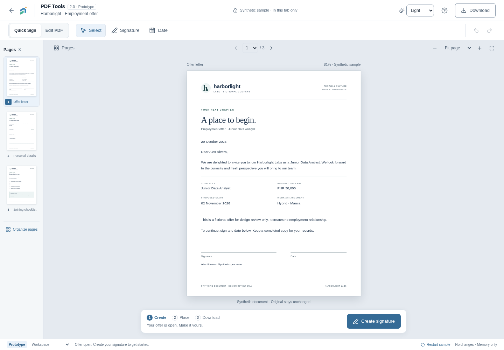

### Desktop dark

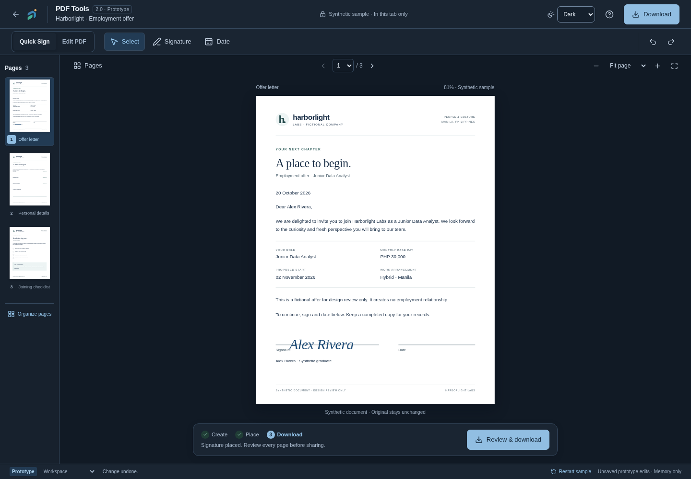

### Tablet

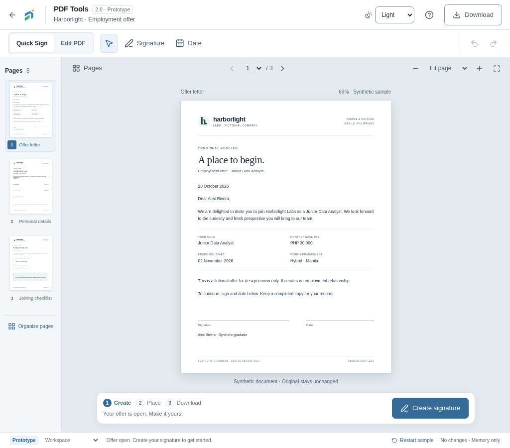

### Mobile

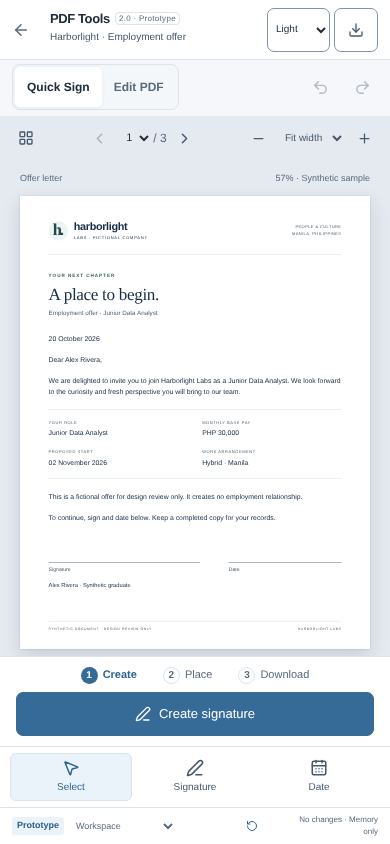

### Create a signature

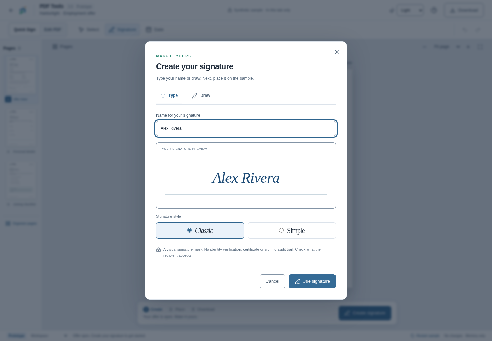

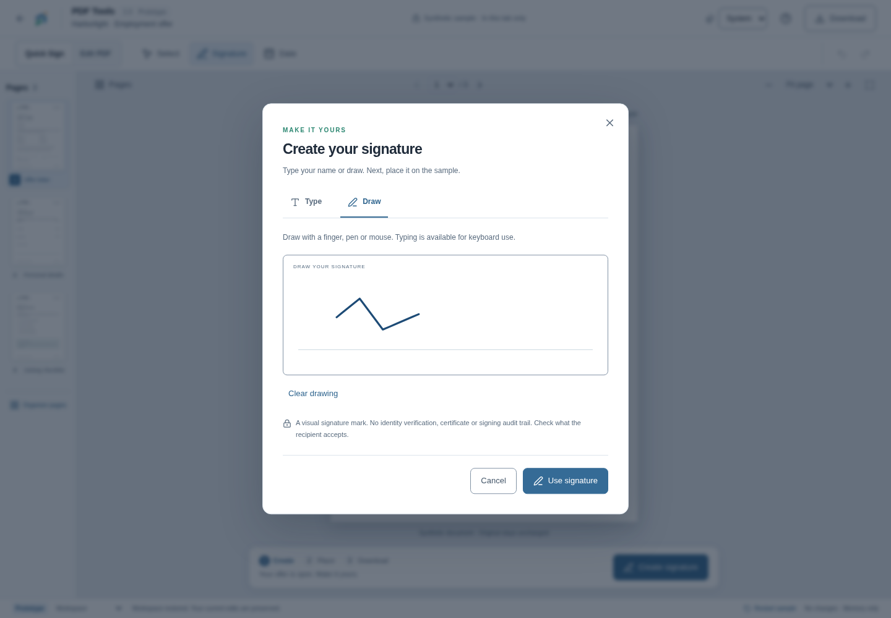

### Place, select and resize

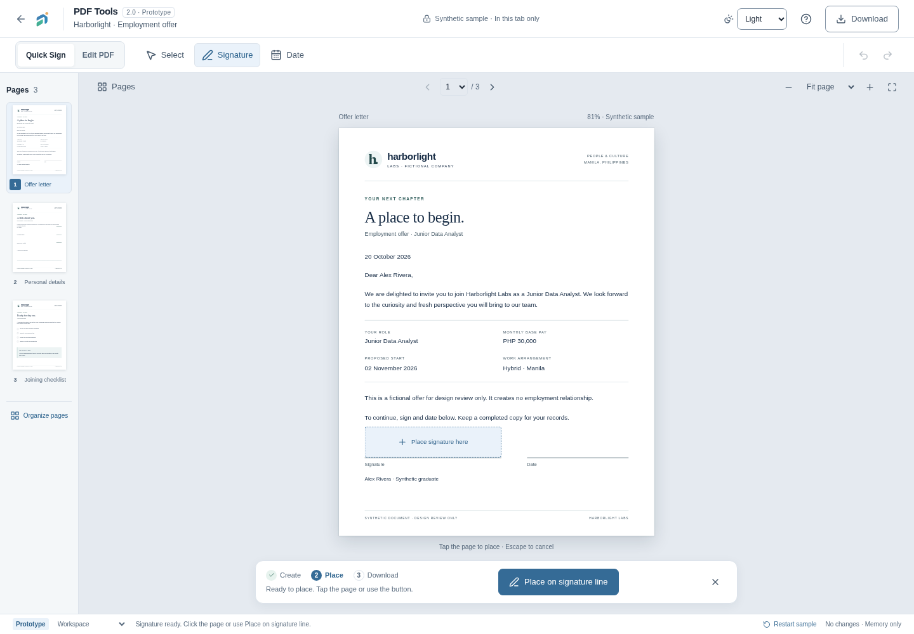

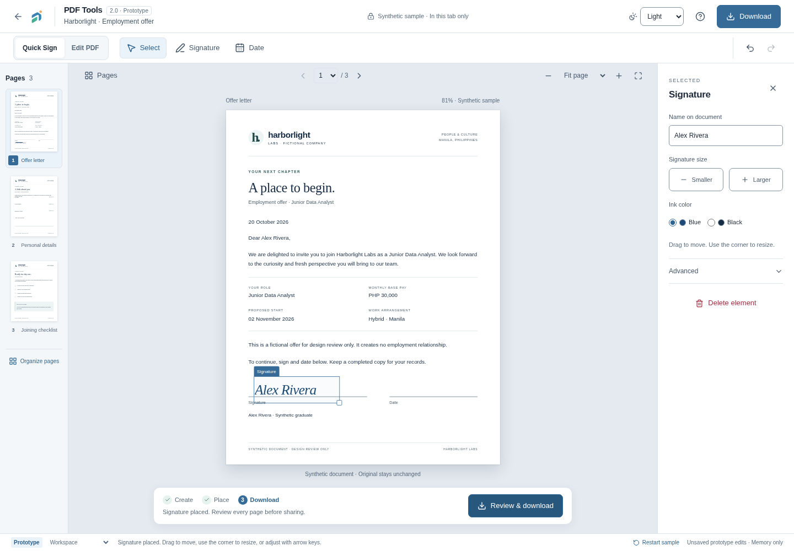

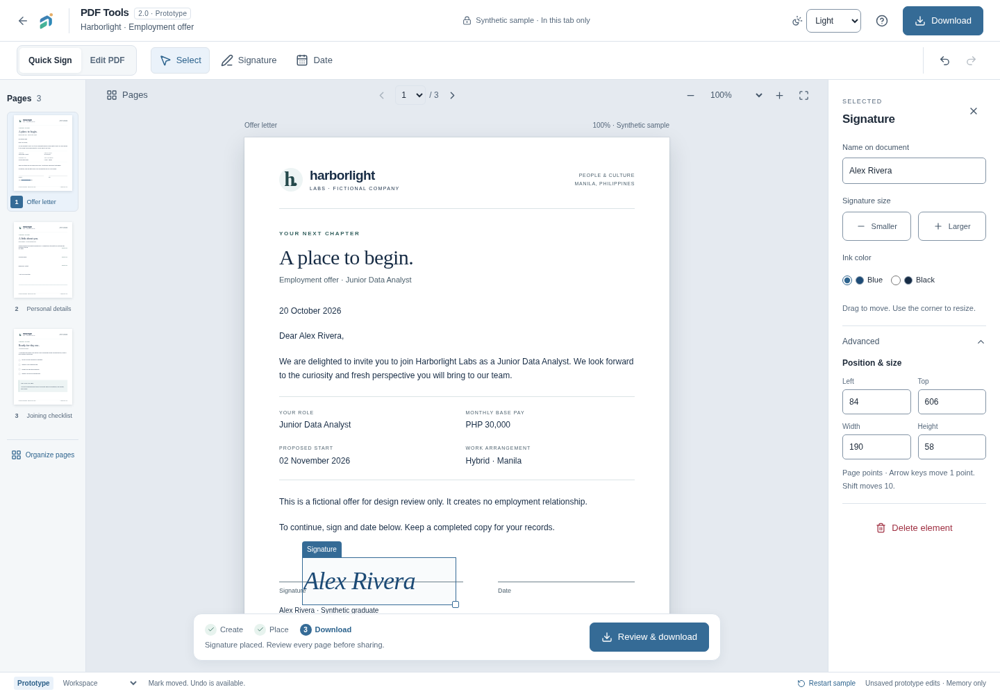

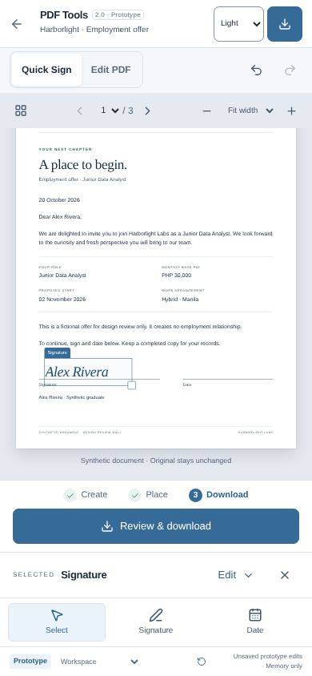

### Text editing

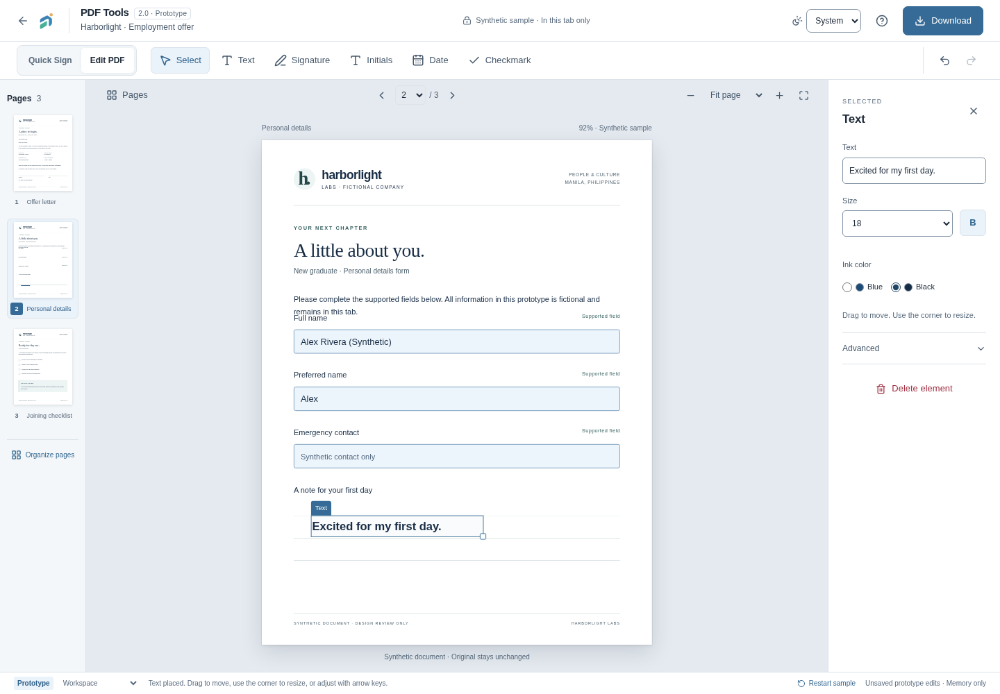

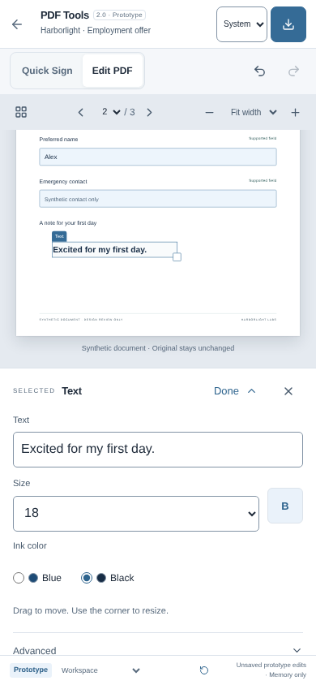

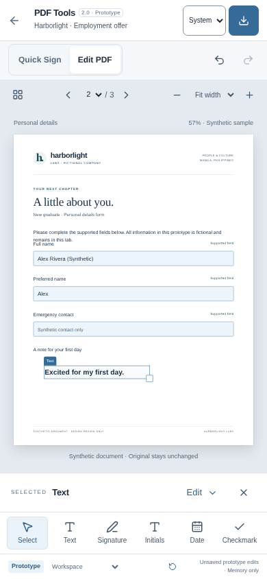

### Narrow phone

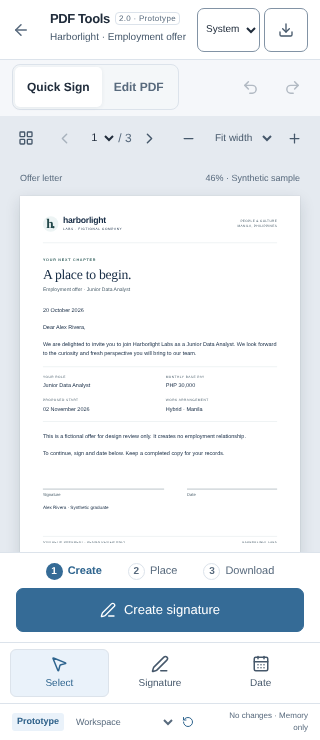

### Multi-page navigation

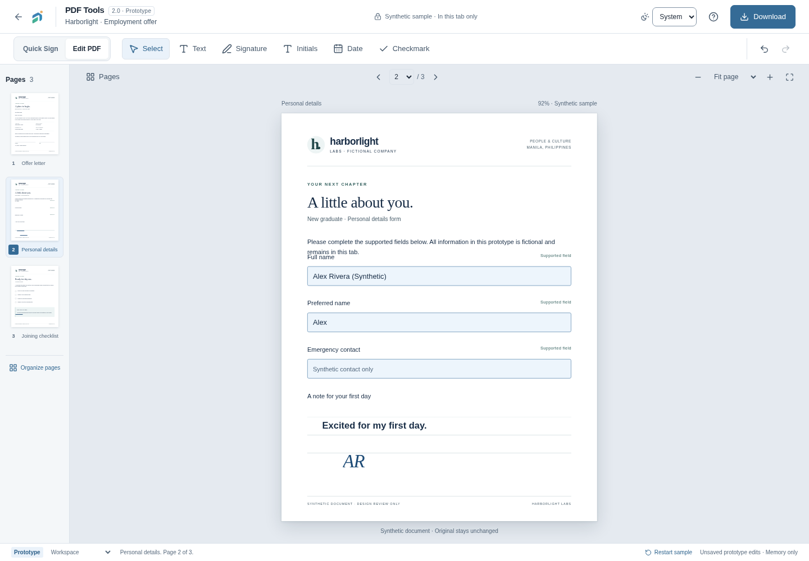

### Feedback and empty state

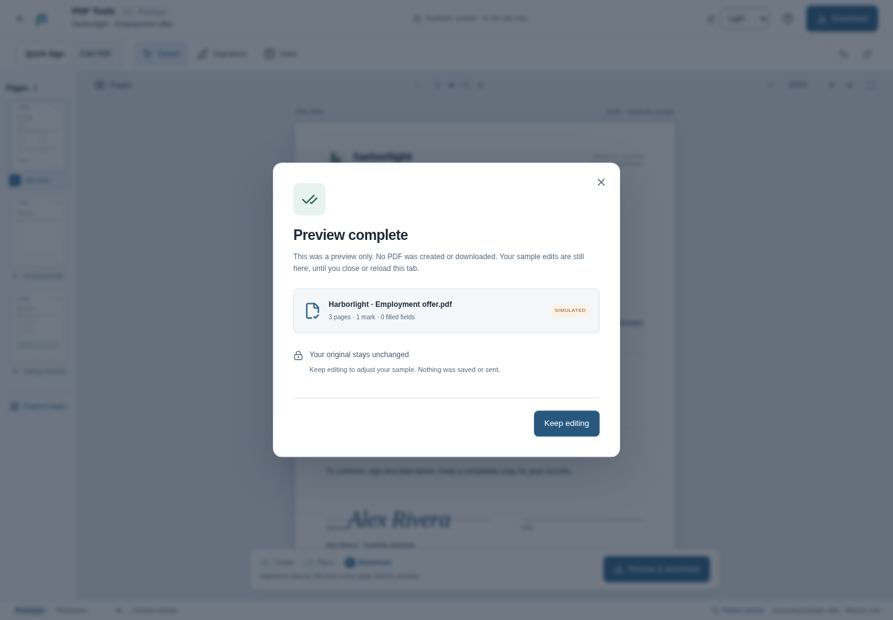

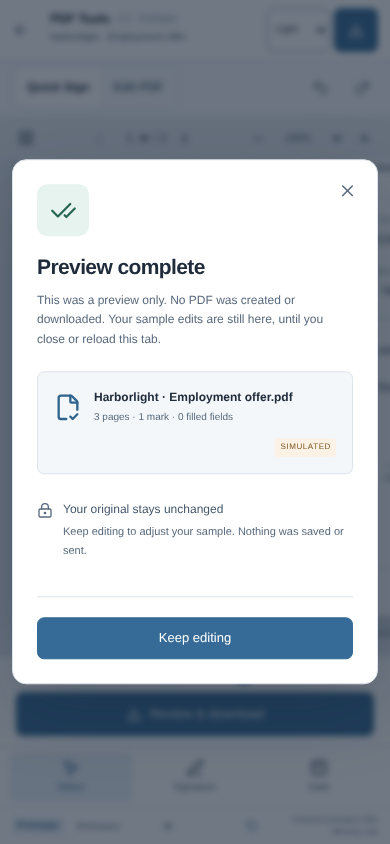

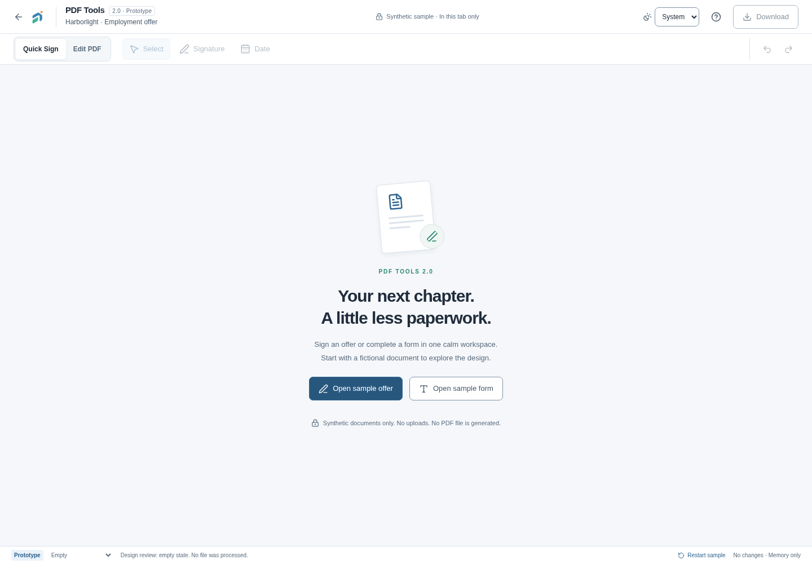

## Original visual inspection and iteration (historical)

Inspected actual renders of the existing editor and the new prototype, not just
DOM snapshots. The baseline editor placed a tall field/tool card beside the
document. The prototype gives the page its own stage and keeps controls compact.
The printed fictional offer uses editorial typography; the FATS chrome retains
the established local sans-serif stack and semantic roles.

| Finding                                                               | Refinement / current decision                                                                                                                       |
| --------------------------------------------------------------------- | --------------------------------------------------------------------------------------------------------------------------------------------------- |
| Initial sample instructions intruded into the signature area          | Shortened synthetic letter copy and reserved a separate signing area; selected-mark screenshot now shows a clear gap                                |
| Mobile properties could cover the signing location                    | Properties became a bounded, independently scrollable tray that occupies layout space; the selected mark scrolls into view                          |
| Mobile Fit page reduced the document too much when properties opened  | Start mobile in Fit width; Fit page remains available as an explicit overview                                                                       |
| Hidden mobile Download text also removed its accessible name          | Added a persistent accessible name and verified the named action in the mobile journey                                                              |
| Signature style preview did not initially carry into placement        | Preserve the selected style in the in-memory mark                                                                                                   |
| Added single-line text could clip after content/size edits            | Expand its approximate content box during edits, bounded to the sample page. Exact font measurement/overflow warning remains an implementation gate |
| Fullscreen design left ordinary shell controls behind it              | Route-qualified CSS hides only the background shell while the prototype is mounted; browser checks require the old topbar to be hidden              |
| Quick Sign's first action needed clearer emphasis                     | Signature receives primary-action styling until a signature has been placed                                                                         |
| Selecting an empty review state could allow silent sample replacement | Sample entry and Restart now share the same explicit discard guard                                                                                  |

Weaknesses recorded in the original milestone (see the refinement pass above for current status):

1. The mobile tray still takes substantial height while editing text; a collapsed
   selection summary may be preferable. Physical onscreen keyboards are untested.
2. Scaled document fields and the illustrated resize handle can be too small for
   reliable touch at Fit width. Production needs screen-space hit targets and a
   non-drag properties path at every scale; this prototype is not accessibility
   conformance evidence.
3. Paper text is intentionally small in an overview. Users need Fit width/zoom
   for reading. Validate toolbar density at 320px and browser text enlargement.
4. Three visual corners are not interactive. Before engineering, either implement
   equivalent handles or simplify the affordance to the supported corner.
5. HTML/SVG geometry and approximate text sizing cannot establish real PDF
   crop/rotation, font fidelity, signature baseline accuracy or export consistency.
6. A real accessible document reading strategy, field validation feedback,
   original supported field types and screen-reader workflows need dedicated
   design/engineering validation. The sample's printed artwork is hidden from
   assistive technology, while its fields and marks are named and operable.
7. Known sample-line placement must never be mistaken for detection on arbitrary
   employment files. The production alternative should say **Place on page**.
8. A long signature may become too small after fitting. Set a minimum readable
   mark size and overflow feedback before real export work.

## Original milestone verification evidence (historical)

Environment: Node 24.21.0, pnpm 11.27.0, installed Next 16.4.0 and Playwright
1.64.1, system Chromium, sandbox enabled. Development/browser operations needed
scoped execution permission after the restricted server returned loopback EPERM
and Chromium's system socket was blocked. No sandbox setting or system package
was changed. Dedicated test contexts start with empty storage; database and AI
configuration are explicitly empty/disabled for browser servers.

The first browser batch passed all three Edit PDF journeys; six other cases
stopped at an overly strict label-based theme selector. Switching the harness to
the existing control's accessible combobox name resolved those harness failures.
A later batch passed eight cases and exposed the unnamed mobile Download action;
that was a prototype accessibility defect and was fixed. Subsequent complete
browser evidence passed all nine journeys. Failures remain in ignored local
iteration directories and were not treated as successful checks.

| Result | Executed check / scope                                                                                                                                                                                                                   |
| ------ | ---------------------------------------------------------------------------------------------------------------------------------------------------------------------------------------------------------------------------------------- |
| PASS   | `FATS_TEST_PORT=3200 pnpm exec playwright test --config=playwright.design.config.ts --output=.fats-private/pdf-tools-2-review/final` — 9/9 journeys across desktop, tablet and mobile, including initials and guarded sample replacement |
| PASS   | `pnpm exec vitest run tests/unit/pdf-tools.test.ts tests/unit/pdf-tools-worker.test.ts tests/unit/theme.test.ts` — 24/24 existing PDF/model/worker/theme cases                                                                           |
| PASS   | `pnpm exec tsc --noEmit -p apps/web/tsconfig.json` and `pnpm exec tsc --noEmit -p tsconfig.tools.json` — web and test/config TypeScript                                                                                                  |
| PASS   | Scoped ESLint over the design components, route, browser tests and config with `--max-warnings=0`                                                                                                                                        |

| Result | Additional executed check / scope                                                                                                                                                                                                                                                                |
| ------ | ------------------------------------------------------------------------------------------------------------------------------------------------------------------------------------------------------------------------------------------------------------------------------------------------ |
| PASS   | `FATS_TEST_PORT=3200 pnpm exec playwright test --config=playwright.design.config.ts --project=desktop --grep 'Quick Sign' --output=.fats-private/pdf-tools-2-review/settled-capture` — one final journey after the screenshot helper began awaiting local font readiness and paint frames        |
| PASS   | `pnpm --filter @fats/web build` with database/provider configuration empty and scoped execution permission — optimized Turbopack production compile, TypeScript and all 19 static pages                                                                                                          |
| PASS   | `FATS_TEST_PRODUCTION=1 FATS_TEST_PORT=3201 pnpm exec playwright test tests/e2e/pdf-tools.spec.ts --output=.fats-private/pdf-tools-2-review/original-editor` — 4/4 unchanged desktop/mobile editor journeys, including real synthetic exports, reopening, unsupported files and discard handling |
| PASS   | Chromium against `next start` on loopback 3201: the design URL renders **This page isn’t here.**, has no prototype region and no sample-open action                                                                                                                                              |
| PASS   | SHA-256 comparison against the preflight manifest — all four moodboards and seven existing PDF component/model/worker files unchanged                                                                                                                                                            |
| PASS   | Comparison of tracked `git diff --numstat` with the saved preflight version — the original 13 tracked changes retained exactly; build-generated Next declaration path churn returned automatically to its starting development form                                                              |
| FAIL   | Root `NX_DAEMON=false NX_ISOLATE_PLUGINS=false pnpm build`, including a scoped verbose retry — the Nx subprocess hit Turbopack loopback binding EPERM. The direct package build above completed successfully; no repository workaround was added                                                 |

Final `pnpm format:check` and `git diff --check` **PASS**. All local
documentation/gallery links resolve. Final test/config TypeScript and focused
browser-test ESLint also **PASS** after the capture-helper refinement.

The production not-found check initially expected HTTP 404 and failed with 200.
The installed Next 16.4 [not-found guide](../apps/web/node_modules/next/dist/docs/01-app/03-api-reference/03-file-conventions/not-found.md)
explains that streaming can retain HTTP 200 while rendering the not-found UI.
Actual production-browser verification confirms that the prototype is unavailable;
this is not reported as an HTTP-404 pass. A first follow-up probe arrived after
the regression server had stopped; it was repeated against a separately started
local production server and passed. Both production servers were stopped.

The optimized build retains the two tracing warnings at unchanged
`apps/web/src/server/document-scanner.ts:40–41`, already documented in
[MVP verification](PDF_TOOLS_VERIFICATION.md). No scanner implementation was
changed to silence them.

An apparent blank-page concern during image inspection was checked against both
the original dark screenshot and a fresh theme/zoom render. Each contained 3,973
dark document pixels in the same 350×400px paper region; computed text was visible
with the expected ink color. A missing-content defect was not reproduced. The
gallery uses actual captures, with no retouching or fabricated document content.

Browser assertions cover signature-dialog focus containment and restoration,
cleared canceled drafts, confirmation-to-placement focus, selecting a new mark,
pointer movement, keyboard nudge, single-gesture resize, resize keys, delete/undo,
retained fields between pages, text properties, page reorder/removal/undo,
explicit unsaved exit, export-failure retry, System theme changes and pointer
drawing. Touch-emulated dragging uses actual Chromium touch input through CDP;
this is automated emulation, not a physical finger trial. Browser request monitors
check for script errors, console errors, non-GET writes and external origins.
All nine final prototype journeys observed none of those failures/writes/external
requests. The state/drawing scenarios also verify that only the existing
appearance preference is written to localStorage.

Reproduce the design suite with no other server on the chosen test port:

```sh
FATS_TEST_PORT=3200 pnpm exec playwright test --config=playwright.design.config.ts --output=.fats-private/pdf-tools-2-review/recheck
```

The design suite deliberately refuses `FATS_TEST_PRODUCTION=1`. Its page is
development-only. Build/browser commands must be sequential because they share
the same `.next` directory. No database, Mailpit, real file, scanner or provider is
needed for this suite.

## Original acceptance status and next decision (historical)

The prototype supports reviewing the two journeys and the workspace's appearance
and interaction model. **No participant-based usability criterion has passed.**
The six-interaction budget, 90-second first-time signing target, placement
tolerances, tool-discovery times and responsive/a11y release gates are proposals
in the [acceptance matrix](PDF_TOOLS_2_DESIGN.md#7-measurable-acceptance-criteria).
Automated scripted completion cannot establish first-time intuition.

NOT RUN: graduate usability sessions; assistive-technology and screen-reader
testing; physical iOS/Android/stylus tests; full accessibility audit/contrast
measurement; 320px/200% zoom/virtual keyboard validation; genuine PDF preview/export
consistency or performance; DocHub screenshot comparison. Existing real-editor
regressions test the existing editor, not a future PDF Tools 2.0 engine.

Recommended decision: approve or revise the focused workspace, Quick Sign path,
selection properties and mobile tray before engineering. Then run formative
tasks, resolve target placement/field accessibility and the missing reference,
and authorize the first implementation milestone separately. Keep page
organization as a distinct model/export slice and library handoff deferred while
required scanning remains unavailable.

No deployment, commit, push, ClamAV install, AI activation, scanner bypass or
certified e-signature work was performed. The previous milestone remains
uncommitted by instruction.
