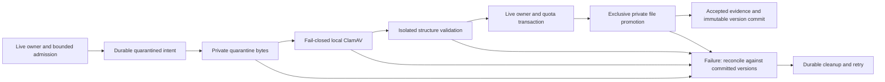

# Private Beta Hardening 2 — safe document intake

Date: 2026-10-17. Starting checkpoint: clean `main` at `0bdcc78` (`fix(security): harden account erasure and document uploads`), including the manually committed Hardening 1 milestone. No commit, push, deployment, resource purchase, real-data access or AI provider call was made. Existing Phase 5 identities/version history, Phase 6 contracts/provider implementation, and earlier verification reports remain.

**Partial milestone; real-data beta remains blocked.** Private quarantine, fail-closed integration, process containment and lifecycle recovery have local evidence below. ClamAV is absent; no installed engine version, current signature database, actual clean scan, EICAR detection or scanner resource behavior has been verified. The narrow adapter is implemented, not certified working. A temporary local installation was requested separately; without that authorization no package/signature download or NixOS configuration change is performed. Synthetic scanner receipts used by persistence tests are explicitly not antivirus evidence.

## Lifecycle and ownership

Migration `0009_document_intake.sql` extends the existing durable `document_objects` ledger with `legacy`, `quarantined` and `accepted` states, exact accepted SHA-256 and scanner engine/signature/time evidence. It does not change immutable `document_versions` or manufacture clean results for old files. No background job platform or new package dependency is introduced.



`FilesystemDocumentStorage` stages opaque server UUID filenames as 0600 files under a canonical 0700 `FATS_DOCUMENTS_DIR/quarantine/`. This is outside public serving paths. Original filenames never become paths. Files are synced and published exclusively. Promotion verifies size/hash, atomically hard-links to the accepted root on the same filesystem, syncs that directory, and unlinks/syncs quarantine. **SQL commit, promotion and quarantine unlink are separate durable steps, not one atomic transaction.** The accepted namespace is private too; only committed accepted versions pass application authorization. Erasure completion covers the tracked persistent store, not RAM zeroing: if the web caller crashes, a previously started tool can retain isolated volatile stdin/tmpfs copies until its OS deadline (at most 30 seconds of tool execution). These have no application download/preview path and no persistent host temp directory. Keep the app stopped, inspect/stop its remaining transient units after a crash, then run recovery; immediate recall of volatile process/browser copies is not claimed.

The live owner, owner/global admission locks and durable intent cover the entire intake. A 200 ms account-state monitor aborts scanning/parsing when the account becomes unavailable; the final transaction repeats the active-owner check under its row lock. Erasure revokes sessions/access immediately upon its committed request, waits/retries pending intake through the existing owner lock, and removes both accepted/quarantine blobs and partials. A write already holding the owner row lock finishes before deletion can be marked, after which its bytes are included in erasure. This preserves Hardening 1 ordering and idempotent receipts.

Normal failures reconcile unreferenced intents under the owner row lock before unlinking. Ambiguous commits are checked against live versions; committed files are not speculatively deleted. Interrupted work retains its durable ledger/journal. `pnpm data:cleanup` excludes active intake and retries tracked unused objects, including both promotion locations. Unknown inventory is reported, never guessed away. Cleanup is operator-driven, not a scheduled service.

Downloads/previews, new application/offer links and local extraction require an accepted receipt matching the exact version hash. Quarantine has no version/download URL. Old or restored unverified versions preserve metadata/links/history but show an actionable unavailable message and cannot be opened or selected as usable files. A clean scan does not make a file harmless, and accepted files are not automatically rescanned when signatures change.

## Scanner implementation and current limitation

The adapter invokes local `clamscan` per file inside the same containment mechanism as the parser, with read-only official signatures and document bytes on stdin. No daemon socket, third-party scanning service, public scanning endpoint, automatic network access or persisted scanner copy is introduced. Per-scan engine loading trades throughput for simple bounded ownership/temp cleanup; intended-host capacity remains unmeasured.

Acceptance requires all of the following (actual ClamAV compatibility remains unverified):

- A canonical private 0700 `FATS_CLAMAV_DATABASE_DIR`, recognizable main/daily CVD or CLD headers, a daily signature age at most 48 hours and at most five minutes in the future.
- An actual `clamscan --version` engine response; exact engine/revision/timestamp agreement before and after the scan. The accepted SHA-256 binds evidence to the bytes parsed and stored.
- Official-database-only loading, ClamAV's database-age guard, successful exit, explicit `stdin: OK`, and no diagnostic output. Empty/partial/unexpected success output is insufficient.
- Detection rejects the document with a generic actionable error. Scanner errors, stale/unavailable signatures, missing binaries, timeout, cancellation, output/resource limits and unavailable isolation fail closed. There is no application configuration that fabricates a clean result.

Configured scan bounds are 30 seconds total runtime, 2 GiB cgroup memory/no swap, one CPU equivalent, 32 tasks, 64 descriptors, no core dumps, 64 MiB private tmpfs; 5 seconds engine scan time, 20 MiB member size, 50 MiB scanned expansion, 500 files, recursion 10, and 1 second bytecode time. `--alert-exceeds-max`, encrypted-content and macro alerts prevent limit/unsupported content being silently treated as clean. **These exact options, budgets and output handling must be tested with the selected installed ClamAV version/signatures before beta use.** No current scanner version/signature freshness is reportable on this host.

Extension, MIME, magic bytes, PDF structure and ZIP/XML checks are format validation, not malware scanning. Scanner fixture injection exists only through internal dependency injection used by tests; production routes instantiate the real adapter. No fake scanner can be selected by an HTTP request or beta environment switch.

## Verified parser boundary and limits

Linux/NixOS runtime: systemd 260.4 user services, cgroup v2 memory/CPU/pids delegation, Bubblewrap 0.12.0, util-linux/flock 2.42.3, Node 24.21.0. Fixed commands launch a new transient service and user/PID/mount/network/IPC namespaces for every parser invocation. `KillMode=control-group`, `OOMPolicy=kill`, runtime and CPU limits, and parent stop/kill handling contain hung/exhausted descendants. This is process containment, not a Promise timeout. Probe tests inspect zero main PID and an empty/removed cgroup after termination, including failed units awaiting collection.

| Boundary                | Enforced limit                                                                                                                                                                                                                                                                                                                                                                    |
| ----------------------- | --------------------------------------------------------------------------------------------------------------------------------------------------------------------------------------------------------------------------------------------------------------------------------------------------------------------------------------------------------------------------------- |
| Upload body/admission   | Existing actual-byte 10 MiB cap, nonempty, 30 seconds body time, 1 upload/owner, 2 globally through PostgreSQL locks, 20 attempts/account/database hour. Independently, four shared OS-held processing slots survive caller crashes.                                                                                                                                              |
| Parser process          | 256 MiB cgroup memory including native buffers/descendants, no swap; one CPU equivalent, 32 tasks, 64 descriptors, no cores; V8 old generation 128 MiB and young generation 16 MiB.                                                                                                                                                                                               |
| Runtime                 | Validation 5 seconds; local extraction 10 seconds; systemd stop grace 1 second, bounded launcher/control cleanup. No uploaded command/arguments/mounts are accepted.                                                                                                                                                                                                              |
| Input/output/temp       | Input at most 10 MiB, result at most 128 KiB, drained diagnostic budget 64 KiB; private 16 MiB tmpfs discarded with the namespace. No document content is forwarded to logs.                                                                                                                                                                                                      |
| Files/network           | Read-only public Nix software store, pinned dependency trees, two parser modules and package metadata only. No account database, private store, host `/etc`, environment credentials, user bus or host network is mounted into the parser. Capabilities dropped; nested user namespaces disabled.                                                                                 |
| PDF structure           | Supported unencrypted PDF 1.0–1.7, 1–500 pages, 100,000 object visits; active/embedded actions remain rejected.                                                                                                                                                                                                                                                                   |
| DOCX/ZIP/XML            | Classic stored/deflate ZIP; 500 entries; 20 MiB/entry, 40 MiB total declared/actual expansion; ratio at most max(1 KiB, 200 × compressed size); CRC/path/directory consistency and required OOXML parts. XML depth 100, node-count bounds, no DTD/entities/macros/embedded objects. No recursive archive extraction or disk extraction.                                           |
| Local text extraction   | Existing 30 PDF pages, 24,000 characters/200 segments; both PDF/DOCX now run inside the constrained process. AI remains disabled.                                                                                                                                                                                                                                                 |
| Concurrent tools        | At most two upload pipelines across app processes sharing PostgreSQL; scanner and validator run sequentially. Existing matching extraction has two separate database slots (still disabled by default), so its possible processes are additional, not included in the two-upload count. Operator rechecks use upload slots without consuming a user's hourly HTTP-attempt budget. |
| Existing storage quotas | 100 MiB referenced bytes/account, 50 documents, 20 immutable versions/document. Pending/private leftovers require recovery and headroom monitoring; no global disk quota is claimed.                                                                                                                                                                                              |

Four OS `flock` slots per service Unix user on a host independently bound active parser/scanner groups, including after a web caller dies or loses its database admission. Locks are held by transient services outside the document namespace; children receive no lock descriptor. The private canonical `/tmp/fats-document-slots-<uid>/` contains four empty 0600 lock files under a 0700 directory, with no account/document data. Do not unlink/recreate these files while any tool is running. A killed caller may leave its unit alive until its OS deadline, still isolated and holding a slot; it cannot escape the limit by a restart. This assumes the same shared local `/tmp` and service UID, not a verified cross-container/host limit. At four scanner slots the configured worst-case tool memory ceiling is 8 GiB plus the web/OS; normal database admission usually admits fewer. Host headroom must be measured before deployment.

Real probes successfully parse/extract generated PDF/DOCX, deny host files/loopback network/environment credentials, exhaust native Buffers, spin CPU, spawn children, exceed output and cancel a running CPU process. The web/test parent remains usable afterward. A failed systemd unit can remain briefly visible while collected; tests verify dead processes/cgroup contents rather than confuse `failed` with a running process.

This boundary assumes a healthy trusted Linux kernel, user systemd manager/delegation, public nonsecret Nix store and trusted installed software/configuration. There is no seccomp syscall allowlist or proof against kernel escapes. It is tested in the repository/pnpm runtime, not a standalone Next artifact, Docker host or future hosted service. A deployment must reproduce mounts/dependencies and prove resource delegation/termination rather than silently fall back to workers/in-process parsing.

## Operator setup and recovery (not executed installation)

Do not use real files to configure this pipeline. After separate package/setup authorization, an operator can enter a temporary Nix shell with `nix shell nixpkgs#clamav nixpkgs#bubblewrap nixpkgs#util-linux`, or explicitly provision/pin the equivalent NixOS packages for the application service. No NixOS service/daemon or package was installed by this milestone. The user service must have working cgroup v2 memory/CPU/pids controllers and access to its user systemd bus. Root/system-wide execution is not required or an intended substitute.

Migration 0009 was applied only to dedicated synthetic test databases here. After review, back up the intended workspace and apply its matching migration set with the existing `pnpm db:migrate` before startup; do not use a user database as a rehearsal target. Existing files become unverified, so plan scanner rechecking before reopening document access.

Create a separate private canonical signature directory and Freshclam configuration outside Git/public paths. Configuration needs `DatabaseDirectory /absolute/private/signatures` and `DatabaseMirror database.clamav.net`; update with `freshclam --config-file=/absolute/private/freshclam.conf`. Keep config/directory private, use official signature downloads, and supervise updates/expiry. Freshclam downloads signatures; documents are not sent to it. Respect its retry/cooldown instructions. Pin and record the resolved package/engine version before a release; the illustrative nixpkgs command alone is not a reproducible release pin.

Configure `FATS_CLAMAV_DATABASE_DIR` and the existing private `FATS_DOCUMENTS_DIR` only for the intended local workspace. Binaries resolve from trusted PATH; optional absolute `FATS_CLAMSCAN_PATH`, `FATS_SYSTEMD_RUN_PATH`, `FATS_SYSTEMCTL_PATH`, `FATS_BWRAP_PATH`, `FATS_FLOCK_PATH` override executable locations (never upload values). The parser currently requires Nix store paths and the installed pnpm workspace/dependency layout.

```sh
pnpm documents:scanner
FATS_TEST_CLAMAV=1 pnpm test:integration tests/integration/document-clamav.test.ts
```

The first command reports engine/revision/signature timestamp/age and a parser-boundary probe, with `scanVerified:false`; health alone is not a successful scan. The opt-in integration tests use the real adapter for clean generated PDF/DOCX, the harmless recognized 68-byte EICAR antivirus fixture, and default-repository promotion/rejection/download behavior. The fixture bytes were checked against their canonical MD5 (44d88612fea8a8f36de82e1278abb02f); this is fixture validation, not antivirus detection. It must pass, followed by actual unavailable/timeout/resource/failure and browser journeys on that configured engine. Never replace official signatures with a toy test database or mark scanner fixtures as real clean results.

After crash/interruption, or after restoring the exact compatible archive into an independently selected fresh private directory/database, keep access stopped:

```sh
pnpm data:cleanup
pnpm documents:scanner
pnpm documents:recheck
pnpm documents:check
```

Use matching database/root configuration for all commands. Restore invalidates acceptance evidence to `legacy` without changing immutable versions/bytes, so old scan receipts cannot re-enable restored files. `documents:recheck` scans and structurally validates existing unverified bytes before accepting their exact hash; missing/corrupt/unsafe/unscannable files remain blocked and contribute to aggregate pending counts/unsuccessful exit. It prints no document names/content/paths. Rechecking has bounded per-file tools/admission, but no background retry service. Do not reopen intake/access while required checks remain unsuccessful. On containment/control failures stop the app, inspect/stop remaining `fats-document-*.service` units and restore working delegation before retrying. Do not disable guards to clear a pending count.

Historical backups/WAL/snapshots, external/provider copies, Mailpit messages, downloads and browser drafts remain subject to Hardening 1 exclusions and independent deletion/retention policy. Reconcile the deletion register before reopening restored data. Unknown pre-ledger files and backup expiry/off-device retention are operator obligations; this milestone does not erase historical archives.

## Executed verification

All fixtures/data are synthetic and dedicated local test PostgreSQL/Mailpit are separate from normal development. Scoped permissions allow local Docker, user D-Bus/cgroup tests and sandbox-enabled Chromium. No normal development database was migrated or seeded, and no normal environment file was rewritten. The read-only scanner-health command loads usual operator configuration but does not connect to PostgreSQL or submit a document.

| Result  | Evidence                                                                                                                                                                                                                                                                                                                                                                                                                            |
| ------- | ----------------------------------------------------------------------------------------------------------------------------------------------------------------------------------------------------------------------------------------------------------------------------------------------------------------------------------------------------------------------------------------------------------------------------------- |
| PASS    | Preflight clean `main`, Hardening 1 checkpoint `0bdcc78`; installed runtime discovery and actual systemd/Bubblewrap containment probe.                                                                                                                                                                                                                                                                                              |
| PASS    | `pnpm db:test:up`; dedicated local PostgreSQL, no credentials printed.                                                                                                                                                                                                                                                                                                                                                              |
| PASS    | `pnpm test:integration --exclude tests/integration/matching.test.ts`: 67 passed / 8 files; two real-ClamAV tests skipped. Final full run includes the OS-slot caller-crash fault test and native cleanup/recheck CLI checks. Auth, complete erasure, cross-user safety, admission, offers, JSON/SQL backup and disposable file recovery regressions included.                                                                       |
| PASS    | Seven new PostgreSQL intake cases plus a real OS runtime crash case: quarantine invisibility, idempotent accepted retries, scanner failures, malformed documents, interrupted dual-copy promotion, partial quarantine writes, deletion/cancellation during scanning, unmodified legacy version rechecking and missing default scanner. Persistence success uses the explicit test-only synthetic adapter, never antivirus evidence. |
| PASS    | `pnpm exec vitest run --exclude 'tests/unit/matching*.test.ts'`: 174 tests / 16 files. Scanner adapter output/error/freshness cases, real process probes, format/decompression/body/storage limits and all existing non-AI domain/persistence regressions.                                                                                                                                                                          |
| PASS    | `NX_DAEMON=false NX_ISOLATE_PLUGINS=false pnpm typecheck` and `pnpm lint`: four projects; unchanged domain/extension tasks cached, changed web/tools executed in the final run.                                                                                                                                                                                                                                                     |
| PASS    | Final `pnpm build` with the Nx environment flags: Next compilation, TypeScript and route generation; changed web build executed, unchanged domain prerequisite cached. `pnpm exec playwright test --config=playwright.config.ts` with the Nx flags: **46/46** desktop/mobile guest journeys.                                                                                                                                        |
| NOT RUN | Actual ClamAV engine/signature/EICAR/timeout/resource verification; no scanner installed/configured. Accepted-file browser journeys cannot be verified through production intake without it.                                                                                                                                                                                                                                        |

Additional browser verification: `FATS_TEST_PRODUCTION=1 NX_DAEMON=false NX_ISOLATE_PLUGINS=false pnpm test:e2e:account tests/account-e2e/accounts.spec.ts tests/account-e2e/recovery.spec.ts tests/account-e2e/portable-backups.spec.ts tests/account-e2e/document-intake.spec.ts` **PASS 24/24**; `pnpm test:e2e:account tests/account-e2e/offers.spec.ts --grep 'minimal offer|lost committed'` with the same environment **PASS 4/4**. These cover 28 distinct production account scenarios across desktop/mobile, including genuine unavailable-scanner 503/form preservation (no request interception), legacy 409 preview/download denial, and actual erasure of both legacy/quarantine files. Accepted-upload/letter journeys remain **NOT RUN** with no real scanner; no fake clean browser mode was introduced. The dedicated unavailable case skips only when a future run explicitly selects actual-scanner configuration, because it exercises the opposite configuration.

Final affected checks: `pnpm exec vitest run tests/unit/matching.test.ts -t 'extracts actual PDF/DOCX'` **PASS 1 selected / 3 filtered**, exercising local PDF/DOCX/empty/image-only/malformed extraction without provider execution. The last production build was followed by `pnpm test:e2e:account tests/account-e2e/document-intake.spec.ts` with the production/Nx environment above: **PASS 4/4** (overlaps the 28 scenarios). Desktop/mobile failure screenshots were inspected and retained locally at `test-results/hardening2-scanner-unavailable-desktop.png` and `test-results/hardening2-scanner-unavailable-mobile.png`; form drafts, readable error copy, labels, focus return and narrow layout remain usable. No accessibility certification or external upload is claimed.

`pnpm documents:scanner` **EXPECTED FAIL, exit 1** with the fixed safe unavailable message: scanner/signature configuration is absent. No engine/version/freshness is fabricated. `pnpm format:check` and `git diff --check` **PASS**. Hash comparisons preserve all 13 baseline files checked: four moodboard PNGs, migrations 0001–0008 and the lockfile. Next generated env declarations were returned to the clean checkpoint. No `fats-document-*.service` test unit remains active; the four intentional empty OS lock files hold no personal data. Dedicated test PostgreSQL/Mailpit remain available with synthetic data; Playwright stopped its local web servers. Changes remain uncommitted for manual review.

Initial failures retained: a storage local-variable shadow and optional-chain syntax error were corrected before integration; a probe correctly exposed Bubblewrap's harmless `PWD` environment entry rather than an entirely empty environment. Migration inventory still expected eight entries and was updated for migration 0009; initial integration run was 65 passed/1 failed, subsequent run 66 passed/1 scanner skip. An initial termination assertion required `inactive`; exhausted units may instead be `failed` while collected, so the stronger assertion verifies zero PID/empty cgroup. An exploratory overly broad unit selection also hit the paused model-comparison plan's frozen source hashes after the security changes; that historical unapproved plan was not rewritten or used to authorize requests. The OS-slot crash fixture initially had an escaped-newline script error, then incorrectly competed with the worker for its readiness lock; a read-only service-state readiness check fixes that fixture. An overlapping diagnostic run also competed for the intentionally shared host slots, so subsequent document tests run sequentially. Matching comparison/evaluation/provider work remains paused.

## Remaining blockers and next bounded milestone

1. **Scanner installation and actual integration verification:** current local intake deliberately rejects files. Configure an authorized pinned local engine/signatures, verify clean/EICAR/timeout/resource behavior and run accepted-file production browser journeys. Until then this milestone's full definition of done is not established.
2. Reproduce containment on the intended runtime, measure concurrent memory/disk/CPU headroom, supervise signature freshness and cleanup, alert on failed units/pending files and rehearse recovery. No global disk quota, process-manager failure recovery service or external penetration/load testing is established.
3. Retention/deletion register, historical backup/WAL/client/inbox exclusions and privacy/support/incident owners; encrypted durable off-device storage and measured restore objectives remain open.
4. Hosted email/recovery reliability, HTTPS, restricted beta access/trusted-proxy/rate-abuse design, operational monitoring and accessibility evidence remain unresolved. No real-data beta is authorized.

Next bounded milestone: **finish authorized local ClamAV configuration and actual scanner/failure/browser verification**, then a separate storage/retention/monitoring/recovery rehearsal on the intended operational setup. No new product phase or AI work is recommended.

References checked: installed Next 16.4 route-handler documentation; [ClamAV scanning](https://docs.clamav.net/manual/Usage/Scanning.html), [official signature updates](https://docs.clamav.net/manual/Usage/SignatureManagement.html), [clamscan options](https://github.com/Cisco-Talos/clamav/blob/main/docs/man/clamscan.1.in); installed systemd 260.4 behavior and its [resource controls](https://github.com/systemd/systemd/blob/v260/man/systemd.resource-control.xml)/[service semantics](https://github.com/systemd/systemd/blob/v260/man/systemd.service.xml); [Bubblewrap security model](https://github.com/containers/bubblewrap/blob/main/README.md). ClamAV source/manual review informs the adapter, not a claim that this host has run it.
